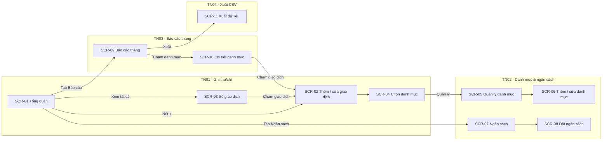

# Đề 2 · App theo dõi chi tiêu

> **Mã:** DE02 · **Độ khó:** 2/8 · **Vai trò:** 1 (người dùng) · **Nền tảng:** App iOS / Android

App giúp một người ghi lại thu chi hằng ngày, đặt ngân sách theo danh mục và xem báo cáo tháng. Dữ liệu lưu trên máy, không cần tài khoản, không kết nối ngân hàng. Đề gồm 4 tính năng; mỗi tính năng có 1 PRD và 1 SRS riêng.

## Tính năng

| **Mã** | **Tính năng** | **Phạm vi** | **PRD** | **SRS** |
| --- | --- | --- | --- | --- |
| TN01 | Ghi thu/chi | Thêm nhanh giao dịch, sửa, xoá có hoàn tác, sổ giao dịch theo ngày | [PRD](docs/TN01-ghi-thu-chi/PRD.md) | [SRS](docs/TN01-ghi-thu-chi/SRS.md) |
| TN02 | Danh mục & ngân sách | Danh mục thu, chi; ngân sách tháng theo danh mục; cảnh báo sắp vượt, đã vượt | [PRD](docs/TN02-danh-muc-ngan-sach/PRD.md) | [SRS](docs/TN02-danh-muc-ngan-sach/SRS.md) |
| TN03 | Báo cáo tháng | Tổng thu, chi, còn lại; cơ cấu chi theo danh mục; so với tháng trước | [PRD](docs/TN03-bao-cao-thang/PRD.md) | [SRS](docs/TN03-bao-cao-thang/SRS.md) |
| TN04 | Xuất CSV | Chọn khoảng thời gian, xuất file CSV, chia sẻ hoặc lưu | [PRD](docs/TN04-xuat-csv/PRD.md) | [SRS](docs/TN04-xuat-csv/SRS.md) |

Thứ tự làm gợi ý: TN01 → TN02 → TN03 → TN04.

## Bản đồ tính năng và màn hình



## Bối cảnh chung

Nhiều người muốn biết tiền của mình đi đâu nhưng bỏ cuộc sau vài ngày vì ghi chép tốn công. App ngân hàng chỉ cho xem sao kê từng tài khoản, không gộp tiền mặt và không phân loại theo nhu cầu cá nhân. Đề này tập trung vào ghi nhanh bằng tay và nhìn lại theo tháng.

| **Nhóm người dùng** | **Nhu cầu chính** |
| --- | --- |
| Người mới đi làm | Biết mỗi tháng tiêu bao nhiêu, vào đâu |
| Sinh viên | Giữ chi tiêu trong khoản được chu cấp |
| Người quản lý chi tiêu gia đình | Đặt hạn mức cho từng nhóm chi, theo dõi cả tháng |

Ngoài phạm vi cả đề: tài khoản và đồng bộ, kết nối ngân hàng, đọc SMS hoặc thông báo, nhiều ví, nhiều loại tiền, giao dịch định kỳ, chia tiền nhóm, quét hoá đơn.

## Quy ước dùng chung

- Tiền tệ: VND, không có số lẻ; hiển thị có dấu chấm ngăn nghìn (ví dụ 45.000 ₫).
- Tháng tính theo lịch, từ ngày 1 đến ngày cuối tháng, theo múi giờ thiết bị.
- Mã BR, MSG, UC đánh số liên tục trong cả đề: TN01 dùng BR-01–10, MSG-01–08; TN02 dùng BR-11–20, MSG-09–16; TN03 dùng BR-21–28, MSG-17–20; TN04 dùng BR-29–35, MSG-21–26. Mã bổ sung sau đánh tiếp từ số cuối: BR-36, MSG-27 (tìm kiếm, lọc sổ giao dịch) ở SRS TN01; BR-37 (xuất kèm danh mục, ngân sách) ở SRS TN04.
- Điều hướng: tab bar Tổng quan · Sổ giao dịch · Ngân sách · Báo cáo; nút "+" nổi ở mọi tab.

## Danh sách màn hình

| **Mã** | **Màn hình** | **Mô tả chi tiết ở** |
| --- | --- | --- |
| SCR-01 | Tổng quan | SRS TN01 |
| SCR-02 | Thêm / sửa giao dịch | SRS TN01 |
| SCR-03 | Sổ giao dịch | SRS TN01 |
| SCR-04 | Chọn danh mục | SRS TN01 |
| SCR-05 | Quản lý danh mục | SRS TN02 |
| SCR-06 | Thêm / sửa danh mục | SRS TN02 |
| SCR-07 | Ngân sách | SRS TN02 |
| SCR-08 | Đặt ngân sách | SRS TN02 |
| SCR-09 | Báo cáo tháng | SRS TN03 |
| SCR-10 | Chi tiết danh mục | SRS TN03 |
| SCR-11 | Xuất dữ liệu | SRS TN04 |

## Cấu trúc repo

```text
de02-theo-doi-chi-tieu/
├── README.md
└── docs/
    ├── TN01-ghi-thu-chi/           PRD.md · SRS.md
    ├── TN02-danh-muc-ngan-sach/    PRD.md · SRS.md
    ├── TN03-bao-cao-thang/         PRD.md · SRS.md
    └── TN04-xuat-csv/              PRD.md · SRS.md
```

## Cách dùng bộ tài liệu

1. Đọc README để nắm phạm vi cả app và danh sách màn hình.
2. Với mỗi tính năng: đọc PRD (vì sao làm, cho ai, đo bằng gì), rồi SRS (quy tắc, trạng thái, use case, màn hình, thông báo).
3. Thiết kế màn hình theo đúng mã SCR, mã MSG trong SRS để dễ đối chiếu khi review.
4. Sơ đồ viết bằng Mermaid, xem trực tiếp trên GitHub hoặc trình xem Markdown có hỗ trợ Mermaid.
