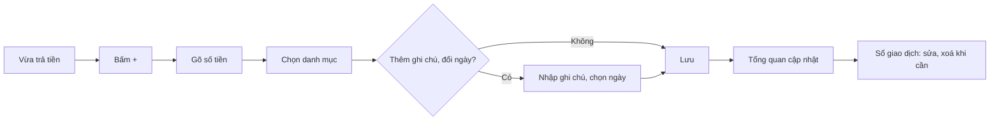

> **Mã:** DE02-TN01-PRD · **Trạng thái:** nháp · **Người viết:** Design (mock) · **SRS:** [SRS.md](SRS.md)

# PRD Ghi thu/chi (App theo dõi chi tiêu)

> **Bản mock.** Con số đánh dấu `[giả định]` dùng để dựng flow, cần PO xác nhận trước khi dùng.

## 1. Bối cảnh và vấn đề

### 1.1 Bối cảnh

App theo dõi chi tiêu cá nhân, dữ liệu lưu trên máy (xem [README](../../README.md)). Mọi báo cáo và ngân sách chỉ có nghĩa khi người dùng ghi đủ giao dịch. Ghi một khoản chi thường diễn ra ngay sau khi trả tiền, lúc người dùng đang đứng ở quầy hoặc đang di chuyển, nên thao tác phải rất ngắn.

### 1.2 Vấn đề

| **Vấn đề** | **Hệ quả** |
| --- | --- |
| Ghi một khoản chi mất nhiều bước | Người dùng để dồn cuối ngày rồi quên |
| Bàn phím chữ khi nhập số tiền | Gõ chậm, dễ sai số 0 |
| Bắt buộc chọn quá nhiều thông tin | Bỏ ghi các khoản nhỏ, số liệu thiếu |
| Ghi nhầm không sửa, không xoá dễ dàng | Số liệu sai kéo dài, mất niềm tin vào báo cáo |
| Không thấy lại các khoản đã ghi theo ngày | Không biết hôm nay đã ghi đủ chưa |

### 1.3 Mục tiêu

- Ghi một khoản chi trong ≤ 10 giây kể từ khi bấm "+" `[giả định]`.
- Người dùng hoạt động ghi trung bình ≥ 3 giao dịch mỗi ngày `[giả định]`.
- Sửa và xoá giao dịch không làm mất dữ liệu ngoài ý muốn.

## 2. Người dùng

| **Nhóm** | **Nhu cầu với tính năng này** |
| --- | --- |
| Người mới đi làm | Ghi nhanh ly cà phê, bữa trưa ngay khi trả tiền |
| Sinh viên | Ghi khoản được chu cấp đầu tháng và các khoản chi lặt vặt |
| Người quản lý chi tiêu gia đình | Ghi bù các khoản của hôm qua, sửa khi nhập sai |

## 3. Phạm vi

### 3.1 Trong phạm vi (MVP)

- Thêm giao dịch chi hoặc thu: số tiền, danh mục, ngày, ghi chú.
- Bàn phím số riêng, có phím "000".
- Gợi ý danh mục dùng gần đây.
- Sửa, xoá giao dịch; xoá có Hoàn tác 5 giây.
- Tổng quan: thu, chi, còn lại của tháng và giao dịch gần đây.
- Sổ giao dịch: nhóm theo ngày, có tổng thu chi mỗi ngày; tìm kiếm theo ghi chú, danh mục, số tiền và lọc theo loại, danh mục.

### 3.2 Ngoài phạm vi

- Nhiều ví, chuyển tiền giữa các ví → phase sau.
- Giao dịch định kỳ, đính kèm ảnh hoá đơn.
- Nhập từ SMS, thông báo ngân hàng, quét hoá đơn.

## 4. Nguyên tắc sản phẩm

### 4.1 Số tiền trước tiên

Mở màn thêm giao dịch là gõ số tiền được ngay. Mọi thứ khác có giá trị mặc định hợp lý.

### 4.2 Mặc định là khoản chi, hôm nay

Phần lớn giao dịch là khoản chi của hôm nay, nên loại và ngày được chọn sẵn như vậy.

### 4.3 Ghi sót vẫn hơn không ghi

Ghi chú không bắt buộc. Cho phép ghi bù ngày đã qua. App không trách người dùng khi ghi muộn.

### 4.4 Sai thì sửa được ngay

Chạm vào giao dịch là sửa. Xoá có Hoàn tác thay cho hỏi xác nhận.

## 5. Quy tắc nghiệp vụ

| **Quy tắc** | **Giá trị** `[giả định]` |
| --- | --- |
| Số tiền | Số nguyên VND, từ 1 đến 999.999.999.999 |
| Loại | Chi hoặc Thu; mặc định Chi |
| Danh mục | Bắt buộc; gợi ý 4 danh mục dùng gần nhất theo loại |
| Ngày | Mặc định hôm nay; chọn được ngày đã qua, không chọn ngày tương lai |
| Ghi chú | Không bắt buộc, tối đa 200 ký tự |
| Hoàn tác xoá | 5 giây |
| Còn lại trong tháng | Tổng thu − tổng chi của tháng đang xem |

- Các giới hạn trên là **cấu hình**, không cố định trong code.

## 6. Luồng trải nghiệm

| **Bước** | **Giai đoạn** | **Trải nghiệm** | **Đầu ra** |
| --- | --- | --- | --- |
| 1 | Mở màn thêm | Bấm "+" ở bất kỳ tab nào; bàn phím số bật sẵn, loại Chi, ngày hôm nay | Sẵn sàng nhập |
| 2 | Nhập số tiền | Gõ số, có phím "000"; số hiển thị có dấu ngăn nghìn | Số tiền hợp lệ |
| 3 | Chọn danh mục | Chạm một trong 4 danh mục gợi ý, hoặc mở danh sách đầy đủ | Danh mục |
| 4 | Bổ sung (tuỳ chọn) | Ghi chú, đổi ngày, đổi sang Thu | Giao dịch đầy đủ |
| 5 | Lưu | Bấm Lưu; về màn trước, số liệu cập nhật | Giao dịch mới |
| 6 | Xem lại | Tổng quan hiện giao dịch gần đây; Sổ giao dịch nhóm theo ngày | Biết đã ghi gì |
| 7 | Sửa, xoá | Chạm giao dịch để sửa; vuốt trái để xoá, có Hoàn tác | Số liệu đúng |

## 7. Use Cases, User Stories và Acceptance Criteria

### UC1. Ghi giao dịch

#### US1.1 Ghi nhanh một khoản chi

User Story: Là người dùng, tôi muốn ghi một khoản chi ngay sau khi trả tiền để không quên.

AC01: Nút "+" hiện ở mọi tab; bấm vào mở màn thêm giao dịch với bàn phím số bật sẵn.

AC02: Loại mặc định là Chi, ngày mặc định là hôm nay.

AC03: Số tiền hiển thị có dấu ngăn nghìn khi đang gõ; có phím "000".

AC04: Hiện 4 danh mục dùng gần nhất của loại đang chọn; chạm là chọn.

AC05: Nút Lưu chỉ bật khi có số tiền > 0 và đã chọn danh mục.

AC06: Lưu xong quay về màn trước; số liệu tháng cập nhật ngay.

#### US1.2 Ghi khoản thu

User Story: Là người dùng, tôi muốn ghi khoản thu để biết tháng này có bao nhiêu tiền.

AC01: Đổi sang Thu bằng nút chuyển ở đầu màn; danh mục gợi ý đổi theo.

AC02: Số tiền thu hiển thị màu khác khoản chi và có dấu "+" ở danh sách.

#### US1.3 Ghi bù ngày đã qua

User Story: Là người dùng, tôi muốn ghi bù giao dịch của ngày đã qua để số liệu vẫn đủ khi quên ghi.

AC01: Chọn ngày có lối tắt Hôm nay, Hôm qua và lịch tháng.

AC02: Không chọn được ngày tương lai.

### UC2. Xem lại giao dịch

#### US2.1 Xem tổng quan tháng

User Story: Là người dùng, tôi muốn mở app là thấy tháng này đã thu chi bao nhiêu.

AC01: Tổng quan hiện tổng thu, tổng chi, còn lại của tháng hiện tại.

AC02: Hiện 5 giao dịch gần nhất, có nút "Xem tất cả" mở Sổ giao dịch.

AC03: Chưa có giao dịch → màn trống mời ghi khoản đầu tiên.

#### US2.2 Xem sổ giao dịch

User Story: Là người dùng, tôi muốn xem sổ giao dịch theo ngày để rà lại từng khoản thu chi trong tháng.

AC01: Giao dịch nhóm theo ngày, mới nhất ở trên; mỗi ngày có tổng chi và tổng thu.

AC02: Chuyển tháng bằng nút trước, sau; không chuyển được sang tháng tương lai.

### UC3. Sửa và xoá

#### US3.1 Sửa giao dịch

User Story: Là người dùng, tôi muốn sửa giao dịch ghi sai để số liệu đúng.

AC01: Chạm vào giao dịch mở màn sửa với dữ liệu đã có; sửa được mọi trường.

AC02: Đổi ngày sang tháng khác → giao dịch chuyển sang tháng đó, có thông báo.

#### US3.2 Xoá giao dịch

User Story: Là người dùng, tôi muốn xoá giao dịch ghi nhầm và hoàn tác được để số liệu đúng mà không sợ xoá nhầm.

AC01: Xoá bằng vuốt trái ở danh sách hoặc nút Xoá ở màn sửa.

AC02: Xoá xong hiện "Đã xoá" kèm Hoàn tác trong 5 giây; số liệu tháng cập nhật ngay và hoàn lại khi hoàn tác.

## 8. Chỉ số theo dõi `[giả định]`

| **Chỉ số** | **Định nghĩa** | **Mục tiêu MVP** |
| --- | --- | --- |
| Thời gian ghi giao dịch | Từ bấm "+" đến lúc lưu | ≤ 10 giây (trung vị) |
| Số giao dịch mỗi ngày | Giao dịch / người dùng hoạt động / ngày | ≥ 3 |
| Tỉ lệ ghi đều | Người dùng ghi ≥ 5 ngày trong 7 ngày / người dùng hoạt động | ≥ 30% |
| Tỉ lệ dùng danh mục gợi ý | Giao dịch chọn từ 4 gợi ý / tổng giao dịch | ≥ 60% |
| Tỉ lệ sửa | Giao dịch bị sửa / tổng giao dịch | Theo dõi; cao là dấu hiệu nhập dễ sai |
| Tỉ lệ ghi bù | Giao dịch có ngày khác ngày tạo / tổng giao dịch | Theo dõi |

## 9. Phụ thuộc và rủi ro

| **Mục** | **Mô tả** | **Hướng xử lý** |
| --- | --- | --- |
| Nhập sai số 0 | 50.000 thành 500.000 | Hiển thị dấu ngăn nghìn khi gõ; đọc số bằng chữ dưới ô nhập |
| Danh mục mặc định | Phụ thuộc bộ danh mục của TN02 | Dùng bộ danh mục có sẵn khi cài app |
| Bỏ cuộc sau vài ngày | Ghi tay tốn công | Giữ thao tác ngắn; nhắc ghi cuối ngày ở phase sau |
| Mất dữ liệu | Dữ liệu chỉ ở trên máy | Xuất CSV ở TN04; nói rõ trong Cài đặt |

## 10. Câu hỏi mở

> Mọi câu hỏi dưới đây đã được PO chốt ngày 13/11/2026; quyết định ghi sau mỗi câu và đã cập nhật vào SRS.

- Có cần đọc số tiền bằng chữ dưới ô nhập để tránh sai số 0? → **Đã chốt:** Có, luôn hiện dưới ô số tiền (SRS BR-01).
- Danh mục có bắt buộc không, hay cho lưu vào "Chưa phân loại"? → **Đã chốt:** Bắt buộc, không có "Chưa phân loại"; luôn có danh mục "Khác" (SRS BR-03).
- Sổ giao dịch có cần tìm kiếm và lọc ở MVP? → **Đã chốt:** Có tìm kiếm và lọc (SRS BR-36).
- Có cho ghi giao dịch ở ngày tương lai (khoản sắp trả) không? → **Đã chốt:** Không (SRS BR-05).
