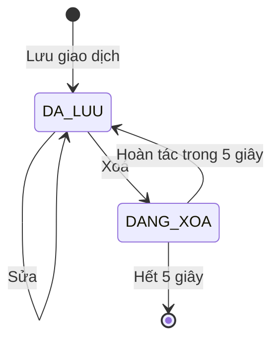
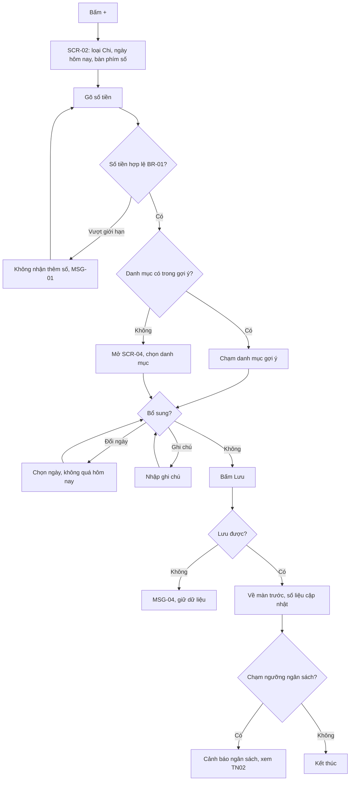
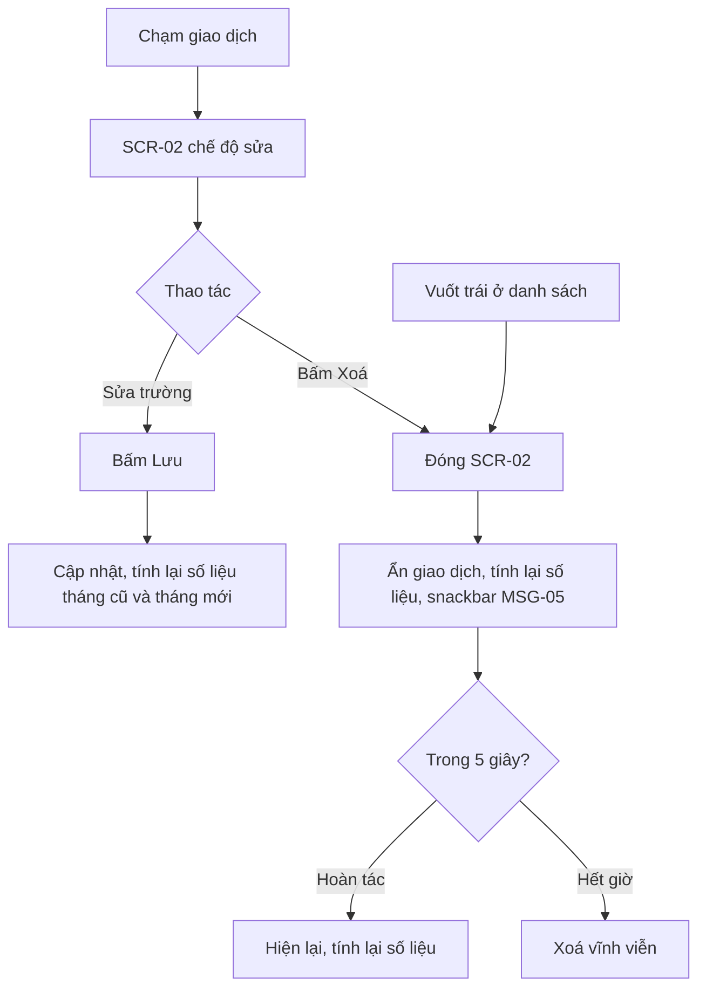
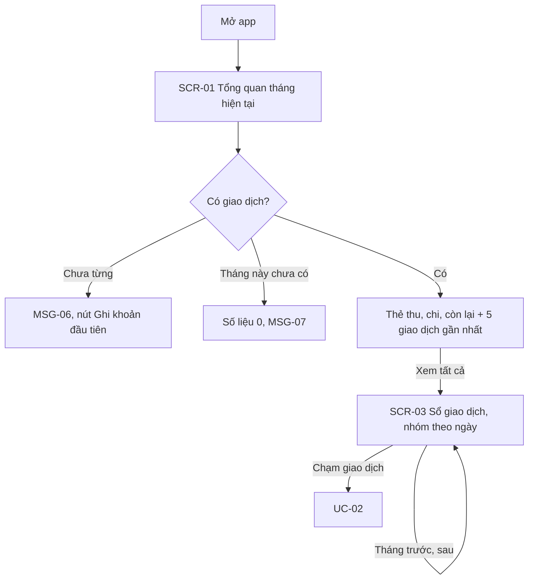
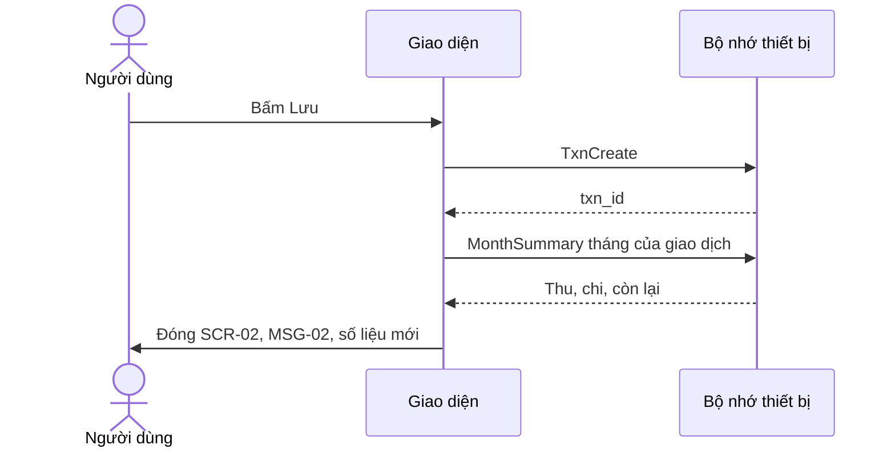

> **Mã:** DE02-TN01-SRS · **Trạng thái:** nháp · **Người viết:** Design (mock) · **PRD:** [PRD.md](PRD.md)

# UC-DE02-01 - Ghi thu/chi

> **Bản mock.** Giá trị `[giả định]` cần BA xác nhận. Danh mục và ngân sách xem [SRS TN02](../TN02-danh-muc-ngan-sach/SRS.md); báo cáo xem [SRS TN03](../TN03-bao-cao-thang/SRS.md).

## 1. Tổng quan

| **Mục** | **Nội dung** |
| --- | --- |
| Mục tiêu | Người dùng ghi, sửa, xoá giao dịch thu chi và xem lại theo ngày, theo tháng |
| Actor | Người dùng · Hệ thống (app và bộ nhớ trên thiết bị) |
| Phạm vi | Thêm, sửa, xoá giao dịch; Tổng quan; Sổ giao dịch |
| Ngoài phạm vi | Nhiều ví, giao dịch định kỳ, ảnh hoá đơn, nhập tự động |
| Nền tảng | App iOS / Android `[giả định]` |
| Figma | `[chưa có]` |

## 2. User Story

| **ID** | **As a** | **I want** | **So that** |
| --- | --- | --- | --- |
| US-01 | Người dùng | Ghi một khoản chi bằng vài chạm | Ghi ngay khi vừa trả tiền |
| US-02 | Người dùng | Ghi khoản thu | Biết tháng này có bao nhiêu tiền |
| US-03 | Người dùng | Ghi bù giao dịch của ngày đã qua | Số liệu vẫn đủ khi quên ghi |
| US-04 | Người dùng | Xem thu, chi, còn lại của tháng | Biết tình hình hiện tại |
| US-05 | Người dùng | Sửa, xoá giao dịch ghi sai | Số liệu đúng |

## 3. Business Rules

| **Mã** | **Quy tắc** |
| --- | --- |
| BR-01 | **Số tiền** là số nguyên VND từ 1 đến 999.999.999.999; hiển thị có dấu chấm ngăn nghìn; không cho nhập số 0 ở đầu `[giả định]` |
| BR-02 | **Loại** gồm Chi và Thu; mặc định Chi. Đổi loại thì bỏ danh mục đã chọn vì danh mục thuộc về một loại |
| BR-03 | **Danh mục** bắt buộc, lấy từ danh sách của TN02 theo đúng loại |
| BR-04 | **Gợi ý danh mục**: 4 danh mục dùng gần nhất của loại đang chọn; chưa đủ lịch sử thì lấy theo thứ tự mặc định `[giả định]` |
| BR-05 | **Ngày** mặc định hôm nay; chọn được mọi ngày đã qua; không chọn ngày tương lai. Giao dịch không lưu giờ, thứ tự trong ngày theo thời điểm tạo |
| BR-06 | **Ghi chú** tối đa 200 ký tự |
| BR-07 | **Xoá giao dịch**: ẩn ngay, số liệu tính lại ngay; Hoàn tác 5 giây; hết giờ thì xoá vĩnh viễn `[giả định]` |
| BR-08 | **Số liệu tháng**: tổng thu, tổng chi, còn lại = thu − chi, tính trên giao dịch có ngày trong tháng đang xem |
| BR-09 | **Sổ giao dịch** nhóm theo ngày giảm dần; trong ngày, giao dịch tạo sau đứng trên; mỗi nhóm hiện tổng chi và tổng thu của ngày |
| BR-10 | Rời màn thêm khi đã nhập số tiền mà chưa lưu → hỏi xác nhận bỏ (MSG-03) |

## 4. Trạng thái

### 4.1 Trạng thái giao dịch

| **Trạng thái** | **Điều kiện** | **Hiển thị** |
| --- | --- | --- |
| `DA_LUU` | Giao dịch đang có hiệu lực | Hiện trong Tổng quan, Sổ giao dịch, được tính vào số liệu |
| `DANG_XOA` | Vừa bị xoá, còn trong 5 giây hoàn tác | Ẩn khỏi danh sách, không tính vào số liệu; snackbar MSG-05 |

### 4.2 Trạng thái màn Tổng quan

| **Trạng thái** | **Điều kiện** | **Hiển thị** |
| --- | --- | --- |
| `TRONG_LAN_DAU` | Chưa từng có giao dịch | MSG-06 + nút "Ghi khoản đầu tiên" |
| `THANG_CHUA_CO` | Tháng này chưa có giao dịch, tháng trước có | Số liệu bằng 0 + MSG-07 |
| `CO_DU_LIEU` | Tháng này có giao dịch | Thẻ số liệu + giao dịch gần đây |

## 5. Use Case

### UC-01 Thêm giao dịch

| **Mục** | **Nội dung** |
| --- | --- |
| Tiền điều kiện | Có ít nhất 1 danh mục của loại đang chọn |
| Hậu điều kiện thành công | Giao dịch được lưu; số liệu tháng, ngân sách, báo cáo cập nhật |
| Hậu điều kiện thất bại | Không tạo giao dịch; dữ liệu đã nhập được giữ trên màn |

**Luồng chính**

| **Bước** | **Actor** | **Mô tả** |
| --- | --- | --- |
| 1 | Người dùng | Bấm nút "+" |
| 2 | Hệ thống | Mở **SCR-02** với loại Chi, ngày hôm nay, bàn phím số; hiện 4 danh mục gợi ý (BR-04) |
| 3 | Người dùng | Gõ số tiền |
| 4 | Người dùng | Chọn danh mục |
| 5 | Hệ thống | Bật nút Lưu khi có số tiền hợp lệ và danh mục |
| 6 | Người dùng | Bấm Lưu |
| 7 | Hệ thống | Lưu giao dịch, đóng **SCR-02**, cập nhật số liệu (BR-08), hiện MSG-02 |

**Luồng thay thế**

| **Mã** | **Điều kiện** | **Xử lý** |
| --- | --- | --- |
| A1 | Đổi sang Thu | Bước 2: danh mục gợi ý đổi theo loại; danh mục đã chọn bị bỏ (BR-02) |
| A2 | Danh mục không có trong gợi ý | Bấm "Tất cả" mở **SCR-04**, chọn xong quay lại **SCR-02** |
| A3 | Đổi ngày | Chọn Hôm qua hoặc mở lịch; ngày tương lai disabled (BR-05) |
| A4 | Ngày thuộc tháng khác tháng đang xem | Bước 7: MSG-02 nêu tháng của giao dịch |
| A5 | Khoản chi làm danh mục chạm ngưỡng ngân sách | Sau bước 7 hiện cảnh báo theo SRS TN02 |
| A6 | Bấm đóng khi đã nhập số tiền | Hỏi MSG-03 (BR-10) |

**Luồng lỗi**

| **Mã** | **Điều kiện** | **Xử lý** |
| --- | --- | --- |
| E1 | Số tiền vượt giới hạn | Không nhận thêm chữ số, hiện MSG-01 |
| E2 | Lưu thất bại | Hiện MSG-04, ở lại **SCR-02** |
| E3 | Loại đang chọn không còn danh mục nào | **SCR-04** hiện màn trống kèm nút "Tạo danh mục" (SRS TN02) |

### UC-02 Sửa và xoá giao dịch

| **Mục** | **Nội dung** |
| --- | --- |
| Tiền điều kiện | Giao dịch tồn tại |
| Hậu điều kiện thành công | Giao dịch được cập nhật hoặc xoá; số liệu tính lại |
| Hậu điều kiện thất bại | Giao dịch giữ nguyên |

**Luồng chính (sửa)**

| **Bước** | **Actor** | **Mô tả** |
| --- | --- | --- |
| 1 | Người dùng | Chạm vào giao dịch ở **SCR-01**, **SCR-03** hoặc **SCR-10** |
| 2 | Hệ thống | Mở **SCR-02** ở chế độ sửa, điền dữ liệu hiện có |
| 3 | Người dùng | Sửa trường cần đổi, bấm Lưu |
| 4 | Hệ thống | Lưu, tính lại số liệu, quay về màn trước |

**Luồng thay thế**

| **Mã** | **Điều kiện** | **Xử lý** |
| --- | --- | --- |
| A1 | Xoá từ **SCR-02** | Đóng màn, thực hiện BR-07 |
| A2 | Xoá bằng vuốt trái | Thực hiện BR-07 tại danh sách |
| A3 | Hoàn tác | Giao dịch hiện lại đúng vị trí, số liệu hoàn lại |
| A4 | Đổi ngày sang tháng khác | Giao dịch rời danh sách tháng đang xem, hiện MSG-08 |
| A5 | Không thay đổi gì rồi bấm đóng | Đóng ngay, không hỏi |

### UC-03 Xem tổng quan và sổ giao dịch

| **Mục** | **Nội dung** |
| --- | --- |
| Tiền điều kiện | Không có |
| Hậu điều kiện | Người dùng thấy số liệu tháng và danh sách giao dịch |

**Luồng chính**

| **Bước** | **Actor** | **Mô tả** |
| --- | --- | --- |
| 1 | Người dùng | Mở app |
| 2 | Hệ thống | Mở **SCR-01**, tính số liệu tháng hiện tại (BR-08), hiện 5 giao dịch gần nhất |
| 3 | Người dùng | Bấm "Xem tất cả" hoặc tab Sổ giao dịch |
| 4 | Hệ thống | Mở **SCR-03** theo BR-09 |
| 5 | Người dùng | Chuyển tháng bằng nút trước, sau |

## 6. Điểm vào

| **Điểm vào** | **Dẫn tới** | **Ghi chú** |
| --- | --- | --- |
| Nút "+" nổi ở mọi tab | UC-01, **SCR-02** | |
| Nút "Ghi khoản đầu tiên" ở màn trống | UC-01 | |
| Chạm giao dịch ở **SCR-01**, **SCR-03**, **SCR-10** | UC-02 | |
| Vuốt trái trên dòng giao dịch | UC-02 (xoá) | |
| Mở app, tab Tổng quan | UC-03, **SCR-01** | |
| Tab Sổ giao dịch | UC-03, **SCR-03** | |

## 7. Mô tả màn hình

### SCR-01 Tổng quan

| **#** | **Thành phần** | **Loại** | **Hành vi** |
| --- | --- | --- | --- |
| 1 | Tháng | Header | "Tháng {m}/{yyyy}" |
| 2 | Thẻ số liệu | Card | Còn lại (số lớn), Tổng thu, Tổng chi; còn lại âm hiện màu cảnh báo kèm dấu "−" |
| 3 | Giao dịch gần đây | List | 5 giao dịch mới nhất; dòng giao dịch dùng chung |
| 4 | "Xem tất cả" | Link | Mở **SCR-03** |
| 5 | Màn trống | Empty state | Theo mục 4.2 |

### SCR-02 Thêm / sửa giao dịch

| **#** | **Thành phần** | **Loại** | **Bắt buộc** | **Validate / hành vi** |
| --- | --- | --- | --- | --- |
| 1 | Loại | Segmented | Có | Chi (mặc định), Thu; đổi loại bỏ danh mục đã chọn |
| 2 | Số tiền | Ô số lớn | Có | BR-01; hiển thị dấu ngăn nghìn và ký hiệu ₫ |
| 3 | Danh mục gợi ý | Chips | Có | 4 danh mục (BR-04) + chip "Tất cả" mở **SCR-04** |
| 4 | Ngày | Dòng chọn | Có | Hôm nay (mặc định), Hôm qua, lịch; ngày tương lai disabled |
| 5 | Ghi chú | Text | Không | BR-06; placeholder "Ghi chú (không bắt buộc)" |
| 6 | Bàn phím số | Keypad | – | 0–9, "000", xoá lùi |
| 7 | Nút Lưu | Button | – | Disabled đến khi có số tiền và danh mục |
| 8 | Nút Xoá | Button text | – | Chỉ có ở chế độ sửa |

### SCR-03 Sổ giao dịch

| **#** | **Thành phần** | **Loại** | **Hành vi** |
| --- | --- | --- | --- |
| 1 | Chọn tháng | Header | Nút trước, sau; nút sau disabled ở tháng hiện tại |
| 2 | Tiêu đề ngày | Section header | "{thứ}, {dd/mm}" + tổng chi, tổng thu của ngày |
| 3 | Dòng giao dịch | List item | Biểu tượng và tên danh mục, ghi chú (1 dòng), số tiền; chi có dấu "−", thu có dấu "+" |
| 4 | Vuốt trái | Gesture | Lộ nút Xoá |
| 5 | Màn trống | Empty state | "Chưa có giao dịch nào trong tháng này" |

### SCR-04 Chọn danh mục (bottom sheet)

| **#** | **Thành phần** | **Loại** | **Hành vi** |
| --- | --- | --- | --- |
| 1 | Lưới danh mục | Grid | Danh mục của loại đang chọn, theo thứ tự của TN02; chạm là chọn và đóng |
| 2 | "Quản lý danh mục" | Link | Mở **SCR-05** (SRS TN02) |

## 8. Dữ liệu và thao tác

App lưu dữ liệu trên thiết bị, không gọi API.

| **Thao tác** | **Input chính** | **Output chính** | **Ghi chú** |
| --- | --- | --- | --- |
| \[TxnCreate\] | type, amount, category_id, date, note | txn_id | BR-01–06 |
| \[TxnUpdate\] | txn_id, các trường thay đổi | updated_at | |
| \[TxnDelete\] | txn_id | – | Gọi khi hết thời gian hoàn tác (BR-07) |
| \[TxnListByMonth\] | month | Giao dịch nhóm theo ngày, tổng mỗi ngày | BR-09 |
| \[MonthSummary\] | month | total_income, total_expense, balance | BR-08 |
| \[CategoryRecent\] | type | 4 danh mục | BR-04 |

**Mô hình dữ liệu**

| **Đối tượng** | **Trường** |
| --- | --- |
| Transaction | id, type (EXPENSE, INCOME), amount, category_id, date, note, created_at, updated_at |
| Category | Xem SRS TN02 |

## 9. Danh sách thông báo

| **ID** | **Nơi hiện** | **Nội dung (VI)** |
| --- | --- | --- |
| MSG-01 | Inline dưới số tiền | Số tiền tối đa là 999.999.999.999 ₫ |
| MSG-02 | Toast | Đã ghi {−/+}{số tiền} ₫ · {danh mục} |
| MSG-03 | Popup | Bỏ giao dịch đang nhập? \[Tiếp tục nhập\] \[Bỏ\] |
| MSG-04 | Popup | Không lưu được giao dịch. Vui lòng kiểm tra dung lượng thiết bị rồi thử lại |
| MSG-05 | Snackbar | Đã xoá giao dịch {số tiền} ₫ · Hoàn tác |
| MSG-06 | **SCR-01** | Bắt đầu theo dõi chi tiêu bằng khoản đầu tiên của bạn. \[Ghi khoản đầu tiên\] |
| MSG-07 | **SCR-01** | Tháng này chưa có giao dịch nào |
| MSG-08 | Toast | Đã chuyển giao dịch sang tháng {m}/{yyyy} |

Bản EN: `[chờ bổ sung]`.

## 10. Yêu cầu phi chức năng

| **Mục** | **Yêu cầu** `[giả định]` |
| --- | --- |
| Hiệu năng | Mở **SCR-02** ≤ 300 ms; **SCR-01** hiện ≤ 1 giây với 10.000 giao dịch |
| Offline | Toàn bộ chức năng chạy không cần mạng |
| Dữ liệu | Số tiền lưu dạng số nguyên, không dùng số thực; không mất dữ liệu khi app bị tắt đột ngột |
| Quyền riêng tư | Không gửi số tiền, ghi chú, danh mục ra ngoài; analytics chỉ gửi sự kiện |
| Log / audit | Ghi trên máy mỗi lần tạo, sửa, xoá, hoàn tác giao dịch kèm thời điểm; không ghi số tiền và ghi chú |
| Tracking | Mở màn thêm, lưu (loại, có ghi chú, ngày khác hôm nay, danh mục từ gợi ý), sửa, xoá, hoàn tác |
| Accessibility | Thu và chi phân biệt bằng dấu "+", "−" chứ không chỉ bằng màu; phím số có nhãn đọc màn hình; vùng chạm ≥ 44 pt |
