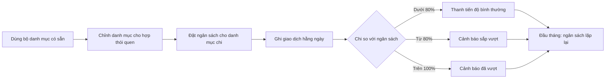

> **Mã:** DE02-TN02-PRD · **Trạng thái:** nháp · **Người viết:** Design (mock) · **SRS:** [SRS.md](SRS.md)

# PRD Danh mục và ngân sách (App theo dõi chi tiêu)

> **Bản mock.** Con số đánh dấu `[giả định]` dùng để dựng flow, cần PO xác nhận trước khi dùng.

## 1. Bối cảnh và vấn đề

### 1.1 Bối cảnh

Giao dịch ở [TN01](../TN01-ghi-thu-chi/PRD.md) luôn gắn với một danh mục. Danh mục quyết định báo cáo có đọc được hay không, còn ngân sách biến việc ghi chép thành hành động: người dùng biết mình còn được tiêu bao nhiêu cho từng nhóm trước khi tiêu.

### 1.2 Vấn đề

| **Vấn đề** | **Hệ quả** |
| --- | --- |
| Bộ danh mục có sẵn không khớp thói quen chi tiêu | Nhiều khoản rơi vào "Khác", báo cáo vô nghĩa |
| Quá nhiều danh mục khi chọn | Chọn chậm, chọn bừa |
| Chỉ biết đã vượt chi khi xem lại cuối tháng | Không kịp điều chỉnh |
| Đặt ngân sách phải tự ước lượng | Đặt quá cao hoặc quá thấp, bỏ dùng |
| Xoá danh mục làm mất giao dịch cũ | Người dùng sợ chỉnh sửa danh mục |

### 1.3 Mục tiêu

- ≥ 40% người dùng hoạt động đặt ít nhất 1 ngân sách `[giả định]`.
- Người dùng biết mình sắp vượt ngân sách trước khi vượt.
- Tỉ lệ giao dịch rơi vào danh mục "Khác" ≤ 15% `[giả định]`.

## 2. Người dùng

| **Nhóm** | **Nhu cầu với tính năng này** |
| --- | --- |
| Người mới đi làm | Đặt hạn mức ăn uống, mua sắm để không tiêu quá lương |
| Sinh viên | Vài danh mục đơn giản, một hạn mức tổng nhỏ |
| Người quản lý chi tiêu gia đình | Danh mục riêng (học phí, tiền chợ), hạn mức từng nhóm |

## 3. Phạm vi

### 3.1 Trong phạm vi (MVP)

- Bộ danh mục có sẵn cho Chi và Thu khi cài app.
- Thêm, sửa, ẩn, xoá, sắp xếp danh mục; mỗi danh mục có tên, biểu tượng, màu.
- Ngân sách tháng theo từng danh mục chi; lặp lại hằng tháng.
- Thanh tiến độ ngân sách; cảnh báo khi đạt 80% và khi vượt 100%.
- Gợi ý mức ngân sách dựa trên chi tiêu tháng trước.

### 3.2 Ngoài phạm vi

- Danh mục con nhiều cấp.
- Ngân sách tổng cho cả tháng, ngân sách theo tuần → phase sau.
- Chuyển phần ngân sách dư sang tháng sau.
- Thông báo đẩy khi vượt ngân sách (MVP chỉ cảnh báo trong app).

## 4. Nguyên tắc sản phẩm

### 4.1 Dùng được ngay, chỉnh sau

App có sẵn bộ danh mục phổ biến. Người dùng không phải thiết lập gì trước khi ghi giao dịch đầu tiên.

### 4.2 Không bao giờ làm mất giao dịch

Xoá hay ẩn danh mục không xoá giao dịch. Danh mục đã có giao dịch thì phải chuyển giao dịch sang danh mục khác trước khi xoá.

### 4.3 Cảnh báo trước khi vượt

Báo ở mốc 80% để người dùng còn kịp điều chỉnh, và báo lại khi vượt. Mỗi mốc chỉ báo một lần mỗi tháng cho mỗi danh mục.

### 4.4 Thông tin, không phán xét

Vượt ngân sách được báo bằng con số và màu cảnh báo, không dùng lời trách móc. App không chặn ghi giao dịch khi đã vượt.

## 5. Quy tắc nghiệp vụ

| **Quy tắc** | **Giá trị** `[giả định]` |
| --- | --- |
| Danh mục có sẵn (Chi) | Ăn uống, Đi lại, Mua sắm, Hoá đơn, Giải trí, Sức khoẻ, Giáo dục, Khác |
| Danh mục có sẵn (Thu) | Lương, Thưởng, Được cho, Khác |
| Tên danh mục | 1–30 ký tự, không trùng trong cùng loại |
| Số danh mục | Tối đa 30 mỗi loại, tính cả danh mục đã ẩn |
| Danh mục "Khác" | Không xoá, không ẩn được |
| Ngân sách | Số nguyên VND > 0, theo danh mục chi, lặp lại hằng tháng |
| Mốc cảnh báo | 80% (sắp vượt) và 100% (đã vượt) |
| Gợi ý mức ngân sách | Tổng chi của danh mục trong tháng trước, làm tròn lên 50.000 ₫ |

- Các giá trị trên là **cấu hình**, không cố định trong code.

## 6. Luồng trải nghiệm

| **Bước** | **Giai đoạn** | **Trải nghiệm** | **Đầu ra** |
| --- | --- | --- | --- |
| 1 | Bắt đầu | Bộ danh mục có sẵn, ghi được giao dịch ngay | Danh mục dùng được |
| 2 | Chỉnh danh mục | Thêm danh mục riêng, ẩn danh mục không dùng, sắp xếp lại | Bộ danh mục cá nhân |
| 3 | Đặt ngân sách | Vào tab Ngân sách, chọn danh mục, nhập hạn mức; có gợi ý từ tháng trước | Ngân sách tháng |
| 4 | Theo dõi | Thanh tiến độ từng danh mục: đã chi, còn lại, số ngày còn lại | Biết còn được tiêu bao nhiêu |
| 5 | Được cảnh báo | Ngay sau khi lưu giao dịch làm chạm mốc 80% hoặc 100% | Kịp điều chỉnh |
| 6 | Sang tháng mới | Ngân sách tự áp dụng lại, tiến độ về 0 | Tháng mới sẵn sàng |

## 7. Use Cases, User Stories và Acceptance Criteria

### UC1. Quản lý danh mục

#### US1.1 Thêm và sửa danh mục

User Story: Là người dùng, tôi muốn có danh mục đúng với cách tôi chi tiêu để báo cáo có ý nghĩa.

AC01: Thêm danh mục với tên, biểu tượng, màu; chọn loại Chi hoặc Thu.

AC02: Tên trùng trong cùng loại → báo lỗi, không lưu.

AC03: Sửa tên, biểu tượng, màu áp dụng cho cả giao dịch cũ.

AC04: Kéo thả để sắp xếp; thứ tự này dùng ở màn chọn danh mục.

#### US1.2 Ẩn và xoá danh mục

User Story: Là người dùng, tôi muốn ẩn hoặc xoá danh mục không dùng để chọn danh mục nhanh hơn.

AC01: Ẩn danh mục → không hiện khi chọn danh mục; giao dịch cũ và báo cáo vẫn giữ.

AC02: Xoá danh mục chưa có giao dịch → hỏi xác nhận rồi xoá.

AC03: Xoá danh mục đã có giao dịch → phải chọn danh mục nhận giao dịch, hoặc chọn ẩn thay vì xoá.

AC04: Danh mục "Khác" không xoá, không ẩn được.

### UC2. Ngân sách

#### US2.1 Đặt ngân sách cho danh mục

User Story: Là người dùng, tôi muốn đặt hạn mức cho từng nhóm chi để không tiêu quá tay.

AC01: Chọn danh mục chi chưa có ngân sách, nhập hạn mức tháng.

AC02: Hiện gợi ý "Tháng trước bạn chi {số tiền}" nếu có dữ liệu; chạm để dùng mức gợi ý.

AC03: Ngân sách áp dụng từ tháng đặt ngân sách và lặp lại các tháng sau. Tháng trước đó không có ngân sách; xem lại tháng đã qua kể từ tháng đặt thì dùng hạn mức hiện tại.

AC04: Sửa hoặc xoá ngân sách không ảnh hưởng giao dịch.

#### US2.2 Theo dõi ngân sách

User Story: Là người dùng, tôi muốn thấy đã chi bao nhiêu so với ngân sách để biết còn được tiêu bao nhiêu.

AC01: Mỗi ngân sách hiện đã chi, hạn mức, còn lại, thanh tiến độ.

AC02: Thanh tiến độ đổi trạng thái ở 80% và 100%, kèm nhãn chữ "Sắp vượt", "Đã vượt".

AC03: Vượt ngân sách hiện "Vượt {số tiền}" thay cho "Còn lại".

AC04: Tháng hiện tại hiện thêm "Còn {n} ngày".

### UC3. Cảnh báo

#### US3.1 Cảnh báo khi ghi giao dịch

User Story: Là người dùng, tôi muốn được cảnh báo khi sắp vượt hoặc đã vượt ngân sách để kịp điều chỉnh.

AC01: Lưu khoản chi làm danh mục đạt 80% → cảnh báo sắp vượt, nêu số còn lại.

AC02: Lưu khoản chi làm danh mục vượt 100% → cảnh báo đã vượt, nêu số vượt.

AC03: Mỗi mốc chỉ cảnh báo một lần mỗi tháng cho mỗi danh mục.

AC04: Cảnh báo không chặn việc lưu giao dịch.

## 8. Chỉ số theo dõi `[giả định]`

| **Chỉ số** | **Định nghĩa** | **Mục tiêu MVP** |
| --- | --- | --- |
| Tỉ lệ đặt ngân sách | Người dùng có ≥ 1 ngân sách / người dùng hoạt động | ≥ 40% |
| Số ngân sách trung bình | Ngân sách / người dùng có ngân sách | Theo dõi |
| Tỉ lệ dùng gợi ý | Ngân sách đặt bằng mức gợi ý / tổng ngân sách | Theo dõi |
| Tỉ lệ vượt ngân sách | Ngân sách bị vượt / tổng ngân sách mỗi tháng | Theo dõi |
| Tỉ lệ giao dịch "Khác" | Giao dịch ở danh mục Khác / tổng giao dịch | ≤ 15% |
| Tỉ lệ tuỳ chỉnh danh mục | Người dùng thêm hoặc sửa ≥ 1 danh mục / người dùng hoạt động | Theo dõi |

## 9. Phụ thuộc và rủi ro

| **Mục** | **Mô tả** | **Hướng xử lý** |
| --- | --- | --- |
| Xoá danh mục | Mất liên kết giao dịch cũ | Bắt chuyển giao dịch hoặc ẩn thay vì xoá |
| Cảnh báo gây khó chịu | Báo nhiều lần, giọng trách móc | Mỗi mốc một lần mỗi tháng; lời lẽ trung tính |
| Ngân sách không thực tế | Người dùng đặt bừa rồi bỏ | Gợi ý từ chi tiêu tháng trước |
| Đổi ngân sách giữa tháng | Tiến độ nhảy đột ngột | Tính lại ngay, không giữ lịch sử mức cũ ở MVP |

## 10. Câu hỏi mở

> Câu nào đã có giá trị ở mục 5 thì giá trị đó là **tạm chốt** `[giả định]` để dựng flow. Câu hỏi vẫn để mở cho đến khi PO xác nhận.

- Có cần ngân sách tổng cho cả tháng ngay ở MVP không?
- Mốc cảnh báo 80% có cho người dùng tự chỉnh không?
- Đổi hạn mức giữa tháng có áp dụng cho các tháng đã qua trong báo cáo không?
- Danh mục có cần danh mục con (Ăn uống → Cà phê) không?
