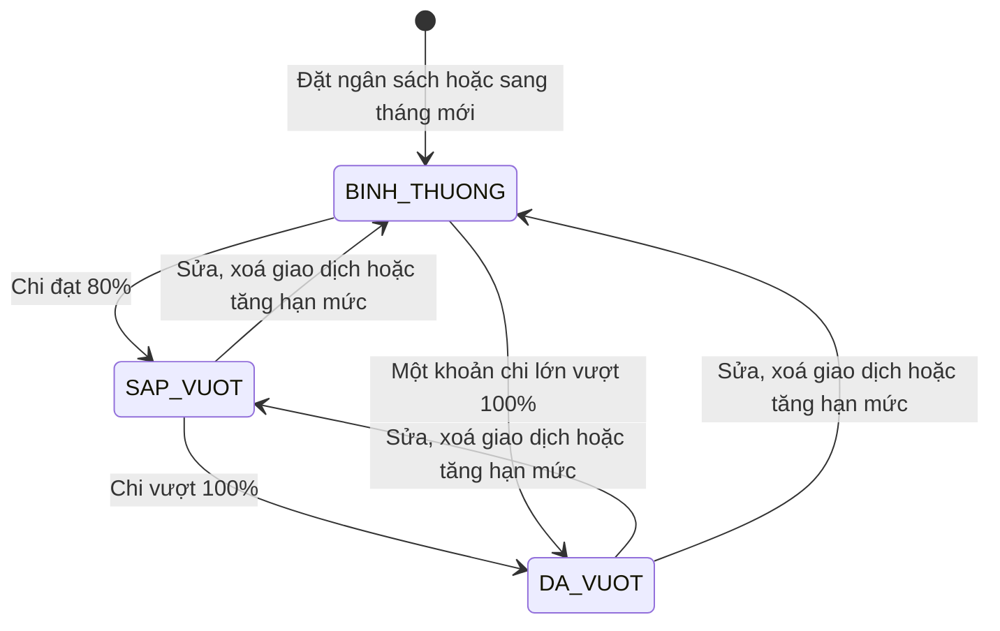
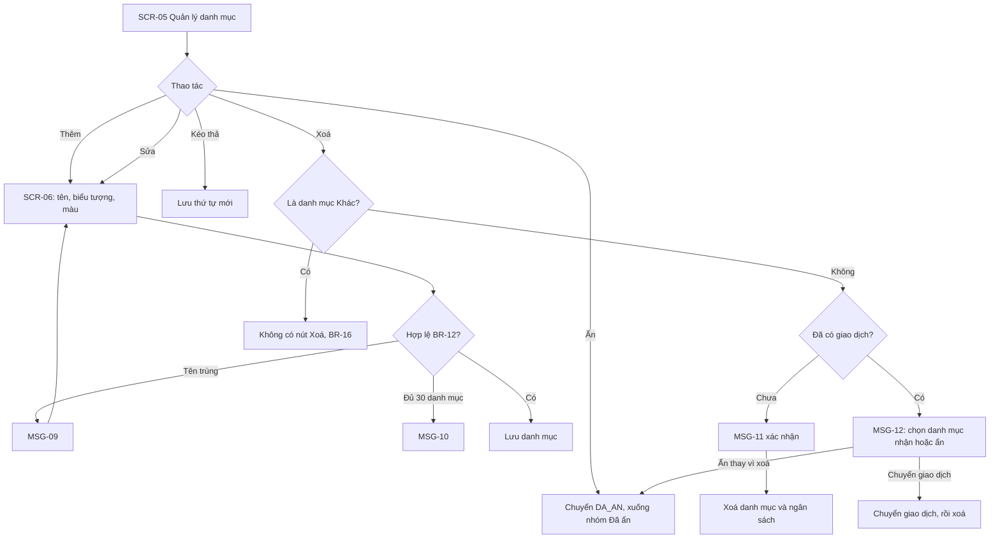
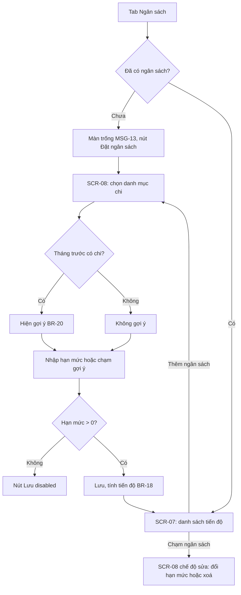
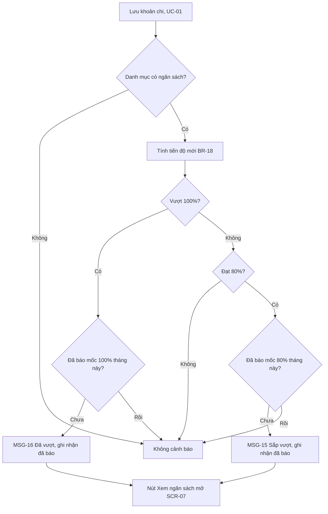
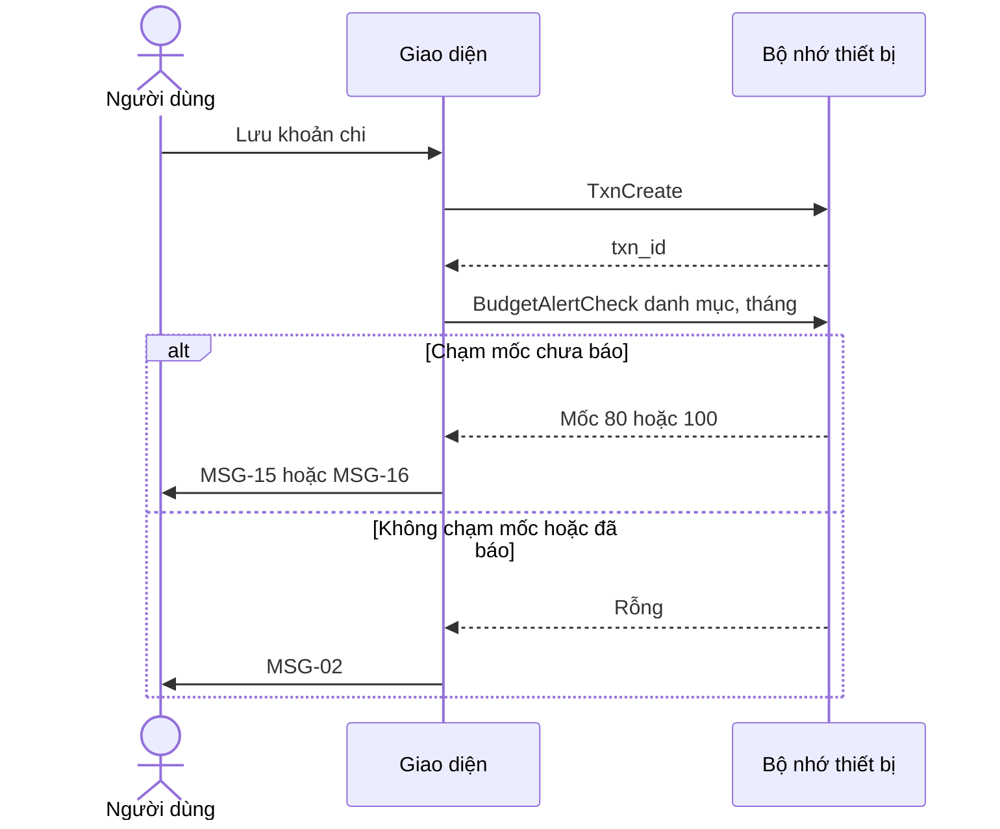

> **Mã:** DE02-TN02-SRS · **Trạng thái:** nháp · **Người viết:** Design (mock) · **PRD:** [PRD.md](PRD.md)

# UC-DE02-02 - Danh mục và ngân sách

> **Bản mock.** Giá trị `[giả định]` cần BA xác nhận. Ghi giao dịch xem [SRS TN01](../TN01-ghi-thu-chi/SRS.md).

## 1. Tổng quan

| **Mục** | **Nội dung** |
| --- | --- |
| Mục tiêu | Người dùng tuỳ chỉnh danh mục, đặt ngân sách tháng theo danh mục chi và được cảnh báo khi sắp vượt, đã vượt |
| Actor | Người dùng · Hệ thống (app và bộ nhớ trên thiết bị) |
| Phạm vi | Quản lý danh mục; đặt, sửa, xoá ngân sách; tiến độ; cảnh báo trong app |
| Ngoài phạm vi | Danh mục con, ngân sách tổng, ngân sách tuần, thông báo đẩy |
| Nền tảng | App iOS / Android `[giả định]` |

## 2. User Story

| **ID** | **As a** | **I want** | **So that** |
| --- | --- | --- | --- |
| US-06 | Người dùng | Thêm, sửa danh mục | Phân loại đúng thói quen của mình |
| US-07 | Người dùng | Ẩn hoặc xoá danh mục không dùng | Chọn danh mục nhanh hơn |
| US-08 | Người dùng | Đặt ngân sách tháng cho danh mục chi | Có hạn mức để bám theo |
| US-09 | Người dùng | Thấy đã chi bao nhiêu so với ngân sách | Biết còn được tiêu bao nhiêu |
| US-10 | Người dùng | Được cảnh báo khi sắp vượt, đã vượt | Kịp điều chỉnh |

## 3. Business Rules

| **Mã** | **Quy tắc** |
| --- | --- |
| BR-11 | Khi cài app, tạo sẵn danh mục Chi: Ăn uống, Đi lại, Mua sắm, Hoá đơn, Giải trí, Sức khoẻ, Giáo dục, Khác; Thu: Lương, Thưởng, Được cho, Khác `[giả định]` |
| BR-12 | **Tên danh mục** 1–30 ký tự, không trùng trong cùng loại (không phân biệt hoa thường). Tối đa 30 danh mục mỗi loại `[giả định]`, **tính cả danh mục đã ẩn**; vì vậy "Hiện lại" một danh mục đã ẩn luôn thực hiện được, không bị chặn bởi giới hạn |
| BR-13 | Danh mục có biểu tượng (chọn từ bộ có sẵn) và màu (bảng 12 màu); loại không đổi được sau khi tạo |
| BR-14 | **Ẩn danh mục**: không hiện ở **SCR-04**; giao dịch cũ, báo cáo, ngân sách đang có vẫn giữ |
| BR-15 | **Xoá danh mục** chưa có giao dịch: xác nhận rồi xoá, kèm xoá ngân sách của danh mục. Đã có giao dịch: phải chọn danh mục cùng loại để nhận giao dịch, hoặc chuyển sang ẩn |
| BR-16 | Danh mục "Khác" của mỗi loại không xoá, không ẩn, không đổi tên |
| BR-17 | **Ngân sách**: mỗi danh mục chi có tối đa 1 hạn mức, số nguyên VND > 0, áp dụng từ **tháng đặt ngân sách** (lưu ở `start_month`) và lặp lại hằng tháng cho tới khi sửa hoặc xoá. Tháng trước `start_month` không có ngân sách. Sửa hạn mức không lưu lịch sử: mức mới áp dụng cho mọi tháng từ `start_month`, kể cả tháng đã qua `[giả định]` |
| BR-18 | **Tiến độ** = tổng chi của danh mục trong tháng / hạn mức. Trạng thái: `BINH_THUONG` (< 80%), `SAP_VUOT` (≥ 80% và ≤ 100%), `DA_VUOT` (> 100%) |
| BR-19 | **Cảnh báo** hiện ngay sau khi lưu giao dịch làm danh mục chuyển sang `SAP_VUOT` hoặc `DA_VUOT`. Mỗi mốc chỉ báo 1 lần mỗi tháng cho mỗi danh mục. Sửa, xoá giao dịch làm tiến độ giảm thì không báo |
| BR-20 | **Gợi ý hạn mức** = tổng chi của danh mục trong tháng trước, làm tròn lên bội số 50.000 ₫; không có dữ liệu thì không gợi ý `[giả định]` |

## 4. Trạng thái

### 4.1 Trạng thái ngân sách trong tháng

| **Trạng thái** | **Điều kiện** | **Hiển thị** |
| --- | --- | --- |
| `BINH_THUONG` | Đã chi < 80% hạn mức | Thanh tiến độ màu thường; "Còn {số tiền}" |
| `SAP_VUOT` | 80% ≤ đã chi ≤ 100% | Thanh màu cảnh báo, nhãn "Sắp vượt"; "Còn {số tiền}" |
| `DA_VUOT` | Đã chi > 100% | Thanh đầy màu vượt, nhãn "Đã vượt"; "Vượt {số tiền}" |

### 4.2 Trạng thái danh mục

`DANG_DUNG` ↔ `DA_AN` (ẩn, hiện lại) · `DANG_DUNG` hoặc `DA_AN` → xoá (BR-15).

## 5. Use Case

### UC-04 Quản lý danh mục

| **Mục** | **Nội dung** |
| --- | --- |
| Tiền điều kiện | Không có |
| Hậu điều kiện thành công | Danh mục được thêm, sửa, ẩn, xoá hoặc sắp xếp lại |
| Hậu điều kiện thất bại | Danh sách danh mục giữ nguyên |

**Luồng chính (thêm danh mục)**

| **Bước** | **Actor** | **Mô tả** |
| --- | --- | --- |
| 1 | Người dùng | Mở **SCR-05** từ Cài đặt hoặc từ **SCR-04** |
| 2 | Người dùng | Chọn tab Chi hoặc Thu, bấm "Thêm danh mục" |
| 3 | Hệ thống | Mở **SCR-06** |
| 4 | Người dùng | Nhập tên, chọn biểu tượng và màu, bấm Lưu |
| 5 | Hệ thống | Kiểm tra BR-12, lưu, thêm vào cuối danh sách |

**Luồng thay thế**

| **Mã** | **Điều kiện** | **Xử lý** |
| --- | --- | --- |
| A1 | Sửa danh mục | Mở **SCR-06** với dữ liệu hiện có; thay đổi áp dụng cho giao dịch cũ |
| A2 | Ẩn danh mục | Chuyển `DA_AN`, đưa xuống nhóm "Đã ẩn" (BR-14) |
| A3 | Hiện lại danh mục | Chuyển `DANG_DUNG`, về cuối danh sách |
| A4 | Xoá danh mục chưa có giao dịch | MSG-11 → xoá (BR-15) |
| A5 | Xoá danh mục đã có giao dịch | MSG-12: chọn danh mục nhận, hoặc "Ẩn thay vì xoá" |
| A6 | Kéo thả | Lưu thứ tự; áp dụng ở **SCR-04** |

**Luồng lỗi**

| **Mã** | **Điều kiện** | **Xử lý** |
| --- | --- | --- |
| E1 | Tên trùng | MSG-09, không lưu |
| E2 | Đã đủ 30 danh mục, tính cả đã ẩn (BR-12) | Nút "Thêm danh mục" disabled kèm MSG-10 |

### UC-05 Đặt và theo dõi ngân sách

| **Mục** | **Nội dung** |
| --- | --- |
| Tiền điều kiện | Có ít nhất 1 danh mục chi |
| Hậu điều kiện thành công | Ngân sách được lưu; tiến độ hiện ở **SCR-07** |
| Hậu điều kiện thất bại | Ngân sách giữ nguyên |

**Luồng chính**

| **Bước** | **Actor** | **Mô tả** |
| --- | --- | --- |
| 1 | Người dùng | Mở tab Ngân sách, bấm "Đặt ngân sách" |
| 2 | Hệ thống | Mở **SCR-08**, liệt kê danh mục chi chưa có ngân sách |
| 3 | Người dùng | Chọn danh mục |
| 4 | Hệ thống | Hiện gợi ý hạn mức nếu có (BR-20) |
| 5 | Người dùng | Nhập hạn mức hoặc chạm gợi ý, bấm Lưu |
| 6 | Hệ thống | Lưu (BR-17), về **SCR-07**, hiện tiến độ theo BR-18 |

**Luồng thay thế**

| **Mã** | **Điều kiện** | **Xử lý** |
| --- | --- | --- |
| A1 | Sửa hạn mức | Chạm ngân sách ở **SCR-07** → **SCR-08** chế độ sửa; lưu thì tính lại tiến độ |
| A2 | Xoá ngân sách | Nút Xoá ở **SCR-08** → MSG-14 xác nhận; giao dịch không đổi |
| A3 | Mọi danh mục chi đã có ngân sách | Nút "Thêm ngân sách" ẩn |
| A4 | Xem tháng đã qua | **SCR-07** chỉ đọc. Tháng từ `start_month` trở đi: tính tiến độ theo hạn mức hiện tại `[giả định]`. Tháng trước `start_month`: danh mục không hiện thanh tiến độ, ghi "Chưa đặt ngân sách trong tháng này" (BR-17) |
| A5 | Chi vừa đặt đã ở mức `SAP_VUOT` hoặc `DA_VUOT` | Hiện đúng trạng thái, không bật cảnh báo vì không phát sinh từ giao dịch |

### UC-06 Cảnh báo ngân sách

| **Mục** | **Nội dung** |
| --- | --- |
| Tiền điều kiện | Danh mục của khoản chi có ngân sách |
| Hậu điều kiện | Người dùng được báo một lần cho mỗi mốc trong tháng |

**Luồng chính**

| **Bước** | **Actor** | **Mô tả** |
| --- | --- | --- |
| 1 | Người dùng | Lưu một khoản chi (UC-01) |
| 2 | Hệ thống | Tính lại tiến độ của danh mục (BR-18) |
| 3 | Hệ thống | Tiến độ chạm mốc chưa báo trong tháng → hiện MSG-15 hoặc MSG-16 (BR-19) |
| 4 | Người dùng | Bấm "Xem ngân sách" hoặc để banner tự ẩn sau 5 giây |

**Luồng thay thế**

| **Mã** | **Điều kiện** | **Xử lý** |
| --- | --- | --- |
| A1 | Một khoản chi vượt cả hai mốc | Chỉ hiện MSG-16; ghi nhận đã báo cả hai mốc |
| A2 | Ghi bù khoản chi của tháng trước | Không cảnh báo |
| A3 | Sửa giao dịch làm tiến độ tăng qua mốc | Cảnh báo như khi thêm mới |

## 6. Điểm vào

| **Điểm vào** | **Dẫn tới** | **Ghi chú** |
| --- | --- | --- |
| Cài đặt → Danh mục | UC-04, **SCR-05** | |
| "Quản lý danh mục" ở **SCR-04** | UC-04, **SCR-05** | Quay lại **SCR-04** sau khi xong |
| Tab Ngân sách | UC-05, **SCR-07** | |
| Sau khi lưu giao dịch | UC-06 | Tự động |
| Nút "Xem ngân sách" trên cảnh báo | **SCR-07** | Cuộn tới danh mục liên quan |

## 7. Mô tả màn hình

### SCR-05 Quản lý danh mục

| **#** | **Thành phần** | **Loại** | **Hành vi** |
| --- | --- | --- | --- |
| 1 | Tab loại | Segmented | Chi, Thu |
| 2 | Danh sách danh mục | List kéo thả | Biểu tượng, tên, tay nắm kéo; chạm mở **SCR-06** |
| 3 | Nhóm "Đã ẩn" | Section | Danh mục `DA_AN`; nút "Hiện lại" |
| 4 | "Thêm danh mục" | Button | Disabled khi đủ 30 (MSG-10) |

### SCR-06 Thêm / sửa danh mục

| **#** | **Thành phần** | **Loại** | **Bắt buộc** | **Validate / hành vi** |
| --- | --- | --- | --- | --- |
| 1 | Tên | Text | Có | BR-12; trùng → MSG-09 |
| 2 | Biểu tượng | Grid chọn 1 | Có | Mặc định biểu tượng đầu tiên |
| 3 | Màu | Bảng 12 màu | Có | Mặc định màu chưa dùng |
| 4 | Xem trước | Chip | – | Hiện danh mục như ở **SCR-04** |
| 5 | Ẩn danh mục | Toggle | – | Chỉ có khi sửa; không có ở danh mục "Khác" |
| 6 | Xoá | Button text | – | Chỉ có khi sửa; không có ở danh mục "Khác" |
| 7 | Lưu | Button | – | Disabled khi tên rỗng |

### SCR-07 Ngân sách

| **#** | **Thành phần** | **Loại** | **Hành vi** |
| --- | --- | --- | --- |
| 1 | Chọn tháng | Header | Nút trước, sau; tháng hiện tại hiện "Còn {n} ngày" |
| 2 | Thẻ ngân sách | Card | Biểu tượng, tên danh mục; "{đã chi} / {hạn mức}"; thanh tiến độ; nhãn trạng thái; "Còn {số tiền}" hoặc "Vượt {số tiền}" |
| 3 | "Thêm ngân sách" | Button | Ẩn khi mọi danh mục chi đã có ngân sách |
| 4 | Màn trống | Empty state | MSG-13 |

Thẻ sắp xếp theo tiến độ giảm dần, để danh mục cần chú ý nằm trên.

### SCR-08 Đặt ngân sách

| **#** | **Thành phần** | **Loại** | **Bắt buộc** | **Validate / hành vi** |
| --- | --- | --- | --- | --- |
| 1 | Danh mục | Chọn 1 | Có | Chỉ danh mục chi chưa có ngân sách; khoá khi sửa |
| 2 | Hạn mức tháng | Ô số | Có | Số nguyên > 0; bàn phím số như **SCR-02** |
| 3 | Gợi ý | Chip | – | "Tháng trước bạn chi {số tiền}" → chạm điền mức gợi ý (BR-20) |
| 4 | Ghi chú lặp lại | Text phụ | – | "Áp dụng hằng tháng cho tới khi bạn thay đổi" |
| 5 | Lưu | Button | – | Disabled khi chưa đủ 1, 2 |
| 6 | Xoá ngân sách | Button text | – | Chỉ có khi sửa; MSG-14 |

## 8. Dữ liệu và thao tác

| **Thao tác** | **Input chính** | **Output chính** | **Ghi chú** |
| --- | --- | --- | --- |
| \[CategoryCreate\] | type, name, icon, color | category_id | BR-12, BR-13 |
| \[CategoryUpdate\] | category_id, name, icon, color, hidden, sort_order | – | BR-14, BR-16 |
| \[CategoryDelete\] | category_id, move_to_category_id | Số giao dịch đã chuyển | BR-15 |
| \[BudgetSet\] | category_id, amount | budget_id | BR-17; lần đặt đầu ghi `start_month` = tháng hiện tại, sửa hạn mức không đổi `start_month` |
| \[BudgetDelete\] | budget_id | – | |
| \[BudgetProgress\] | month | Từng ngân sách: spent, amount, percent, status | BR-18; bỏ qua ngân sách có `start_month` sau `month` (BR-17) |
| \[BudgetSuggest\] | category_id | Mức gợi ý hoặc rỗng | BR-20 |
| \[BudgetAlertCheck\] | category_id, month | Mốc cần báo hoặc rỗng | BR-19 |

**Mô hình dữ liệu**

| **Đối tượng** | **Trường** |
| --- | --- |
| Category | id, type (EXPENSE, INCOME), name, icon, color, hidden, sort_order, is_default_other |
| Budget | id, category_id, amount, start_month, created_at, updated_at |
| BudgetAlertLog | category_id, month, threshold (80, 100), shown_at |

## 9. Danh sách thông báo

| **ID** | **Nơi hiện** | **Nội dung (VI)** |
| --- | --- | --- |
| MSG-09 | Inline | Đã có danh mục tên này |
| MSG-10 | Inline | Bạn đã có 30 danh mục, tính cả danh mục đã ẩn. Xoá bớt để thêm mới |
| MSG-11 | Popup | Xoá danh mục "{tên}"? \[Huỷ\] \[Xoá\] |
| MSG-12 | Popup | "{tên}" đang có {n} giao dịch. Chuyển các giao dịch này sang danh mục khác trước khi xoá. \[Chọn danh mục nhận\] \[Ẩn thay vì xoá\] \[Huỷ\] |
| MSG-13 | **SCR-07** | Đặt hạn mức cho từng nhóm chi để biết mình còn được tiêu bao nhiêu. \[Đặt ngân sách\] |
| MSG-14 | Popup | Xoá ngân sách {danh mục}? Giao dịch của bạn không bị ảnh hưởng. \[Huỷ\] \[Xoá\] |
| MSG-15 | Banner | {Danh mục}: đã dùng {x}% ngân sách tháng, còn {số tiền} · Xem ngân sách |
| MSG-16 | Banner | {Danh mục}: đã vượt ngân sách tháng {số tiền} · Xem ngân sách |

## 10. Yêu cầu phi chức năng

| **Mục** | **Yêu cầu** `[giả định]` |
| --- | --- |
| Hiệu năng | **SCR-07** hiện ≤ 500 ms với 30 ngân sách và 10.000 giao dịch; kiểm tra cảnh báo ≤ 100 ms sau khi lưu |
| Toàn vẹn dữ liệu | Chuyển giao dịch khi xoá danh mục là một thao tác trọn vẹn: hoặc chuyển hết rồi xoá, hoặc không đổi gì |
| Offline | Toàn bộ chức năng chạy không cần mạng |
| Bảo mật | Dữ liệu chỉ lưu trên máy; số tiền và tên danh mục không đưa vào tracking |
| Log / audit | Ghi trên máy mỗi lần tạo, sửa, ẩn, xoá danh mục; đặt, đổi ngân sách; mốc cảnh báo đã hiện theo danh mục và tháng |
| Tracking | Thêm, sửa, ẩn, xoá danh mục; đặt, sửa, xoá ngân sách (có dùng gợi ý); cảnh báo hiện (mốc), bấm Xem ngân sách |
| Accessibility | Trạng thái ngân sách có nhãn chữ, không chỉ dựa vào màu; thanh tiến độ được đọc thành "{x} phần trăm"; kéo thả có thao tác thay thế "Di chuyển lên, xuống" |
