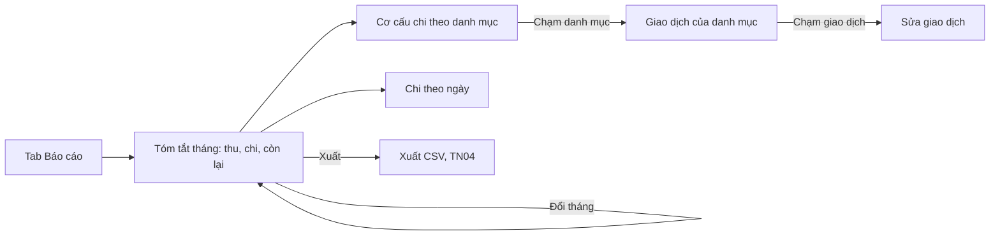

> **Mã:** DE02-TN03-PRD · **Trạng thái:** nháp · **Người viết:** Design (mock) · **SRS:** [SRS.md](SRS.md)

# PRD Báo cáo tháng (App theo dõi chi tiêu)

> **Bản mock.** Con số đánh dấu `[giả định]` dùng để dựng flow, cần PO xác nhận trước khi dùng.

## 1. Bối cảnh và vấn đề

### 1.1 Bối cảnh

Người dùng đã ghi giao dịch ([TN01](../TN01-ghi-thu-chi/PRD.md)) và phân loại theo danh mục ([TN02](../TN02-danh-muc-ngan-sach/PRD.md)). Báo cáo tháng là phần thưởng cho công ghi chép: câu trả lời cho "tiền của tôi đã đi đâu".

### 1.2 Vấn đề

| **Vấn đề** | **Hệ quả** |
| --- | --- |
| Sổ giao dịch chỉ là danh sách dài | Không thấy được bức tranh tổng |
| Không biết nhóm nào chiếm nhiều nhất | Không biết nên cắt giảm ở đâu |
| Không so được với tháng trước | Không biết mình tiêu nhiều lên hay ít đi |
| Biểu đồ đẹp nhưng không bấm vào được | Thấy con số lạ mà không truy ra giao dịch |
| Tháng ít dữ liệu vẫn vẽ biểu đồ | Kết luận sai từ vài giao dịch |

### 1.3 Mục tiêu

- Người dùng trả lời được "tháng này tiêu nhiều nhất vào đâu" trong ≤ 5 giây `[giả định]`.
- ≥ 50% người dùng hoạt động xem báo cáo ít nhất 1 lần mỗi tháng `[giả định]`.
- Mọi con số trong báo cáo truy được về danh sách giao dịch.

## 2. Người dùng

| **Nhóm** | **Nhu cầu với tính năng này** |
| --- | --- |
| Người mới đi làm | Cuối tháng xem tiêu vào đâu, còn dư bao nhiêu |
| Sinh viên | Xem có vượt khoản được chu cấp không |
| Người quản lý chi tiêu gia đình | So tháng này với tháng trước theo từng nhóm chi |

## 3. Phạm vi

### 3.1 Trong phạm vi (MVP)

- Tổng thu, tổng chi, còn lại của tháng; so với tháng trước.
- Cơ cấu chi theo danh mục: biểu đồ tròn và danh sách xếp hạng.
- Chi theo ngày trong tháng: biểu đồ cột.
- Chạm danh mục để xem giao dịch của danh mục đó.
- Chuyển giữa các tháng; chuyển giữa Chi và Thu.

### 3.2 Ngoài phạm vi

- Báo cáo theo tuần, quý, năm; khoảng thời gian tuỳ chọn.
- Xu hướng nhiều tháng, dự báo.
- Nhận xét tự động bằng AI.
- Xuất báo cáo dạng ảnh, PDF (xuất dữ liệu thô ở [TN04](../TN04-xuat-csv/PRD.md)).

## 4. Nguyên tắc sản phẩm

### 4.1 Câu trả lời trước, biểu đồ sau

Đầu màn là ba con số và một câu tóm tắt. Biểu đồ nằm dưới, phục vụ người muốn xem kỹ.

### 4.2 Con số nào cũng truy được

Chạm vào danh mục hay một ngày là thấy đúng các giao dịch tạo nên con số đó.

### 4.3 So sánh có ngữ cảnh

So với tháng trước bằng số tiền chênh lệch và phần trăm. Tháng đang diễn ra thì nói rõ là chưa hết tháng.

### 4.4 Thành thật khi thiếu dữ liệu

Tháng chưa có giao dịch thì nói chưa có, không vẽ biểu đồ rỗng. Không có tháng trước thì không hiện so sánh.

## 5. Quy tắc nghiệp vụ

| **Quy tắc** | **Giá trị** `[giả định]` |
| --- | --- |
| Kỳ báo cáo | Tháng theo lịch; mặc định tháng hiện tại |
| Cơ cấu theo danh mục | Tỉ lệ = chi của danh mục / tổng chi tháng, làm tròn 1 chữ số thập phân |
| Số danh mục trên biểu đồ tròn | 5 danh mục lớn nhất + "Còn lại" gộp các danh mục khác |
| So với tháng trước | Chênh lệch tiền và phần trăm; tháng trước bằng 0 thì chỉ hiện số tiền |
| Tháng đang diễn ra | So với cùng kỳ tháng trước (từ ngày 1 tới cùng ngày), kèm ghi chú "Tháng chưa kết thúc" |
| Danh mục đã ẩn, đã xoá | Danh mục ẩn vẫn hiện trong báo cáo; giao dịch đã chuyển thì tính vào danh mục nhận |

- Các giá trị trên là **cấu hình**, không cố định trong code.

## 6. Luồng trải nghiệm

| **Bước** | **Giai đoạn** | **Trải nghiệm** | **Đầu ra** |
| --- | --- | --- | --- |
| 1 | Mở báo cáo | Tab Báo cáo, mặc định tháng hiện tại | Ba con số tóm tắt |
| 2 | Đọc tóm tắt | Thu, chi, còn lại; mỗi số kèm chênh lệch so với tháng trước | Biết tình hình chung |
| 3 | Xem cơ cấu | Biểu đồ tròn + danh sách danh mục xếp theo số tiền | Biết nhóm chi lớn nhất |
| 4 | Xem theo ngày | Biểu đồ cột chi theo ngày | Biết ngày tiêu nhiều |
| 5 | Truy chi tiết | Chạm danh mục → danh sách giao dịch | Hiểu con số |
| 6 | So tháng | Chuyển tháng trước, sau | So sánh các tháng |

## 7. Use Cases, User Stories và Acceptance Criteria

### UC1. Xem báo cáo tháng

#### US1.1 Xem tóm tắt

User Story: Là người dùng, tôi muốn thấy tổng thu, chi và còn lại của tháng để biết tình hình tài chính.

AC01: Hiện tổng thu, tổng chi, còn lại của tháng đang xem.

AC02: Mỗi số kèm chênh lệch so với tháng trước, bằng tiền và phần trăm, có mũi tên tăng giảm kèm chữ.

AC03: Không có dữ liệu tháng trước → không hiện so sánh.

AC04: Tháng hiện tại hiện ghi chú "Tháng chưa kết thúc".

#### US1.2 Xem cơ cấu chi

User Story: Là người dùng, tôi muốn biết nhóm nào chiếm nhiều tiền nhất để điều chỉnh.

AC01: Biểu đồ tròn hiện 5 danh mục lớn nhất và phần "Còn lại".

AC02: Danh sách bên dưới liệt kê mọi danh mục có chi, xếp theo số tiền giảm dần, kèm số tiền và phần trăm.

AC03: Danh mục có ngân sách hiện thêm trạng thái ngân sách.

AC04: Chuyển sang Thu để xem cơ cấu thu.

#### US1.3 Xem chi theo ngày

User Story: Là người dùng, tôi muốn xem chi theo từng ngày để biết ngày nào tiêu nhiều.

AC01: Biểu đồ cột hiện tổng chi từng ngày trong tháng.

AC02: Chạm một cột hiện ngày và số tiền.

AC03: Hiện mức chi trung bình mỗi ngày.

### UC2. Truy chi tiết

#### US2.1 Xem giao dịch của một danh mục

User Story: Là người dùng, tôi muốn xem giao dịch của một danh mục để hiểu vì sao con số như vậy.

AC01: Chạm danh mục mở danh sách giao dịch của danh mục đó trong tháng.

AC02: Đầu màn hiện tổng tiền, số giao dịch, so với tháng trước.

AC03: Chạm giao dịch mở màn sửa; quay lại thì báo cáo đã cập nhật.

### UC3. Chuyển kỳ

#### US3.1 Xem tháng khác

User Story: Là người dùng, tôi muốn xem báo cáo của tháng khác để nhìn lại chi tiêu trước đây.

AC01: Chuyển tháng bằng nút trước, sau; không chuyển được sang tháng tương lai.

AC02: Tháng không có giao dịch → màn trống nói rõ, không vẽ biểu đồ.

## 8. Chỉ số theo dõi `[giả định]`

| **Chỉ số** | **Định nghĩa** | **Mục tiêu MVP** |
| --- | --- | --- |
| Tỉ lệ xem báo cáo | Người dùng mở báo cáo ≥ 1 lần mỗi tháng / người dùng hoạt động | ≥ 50% |
| Tỉ lệ truy chi tiết | Phiên xem báo cáo có chạm vào danh mục / tổng phiên | ≥ 30% |
| Tỉ lệ xem tháng trước | Phiên có chuyển tháng / tổng phiên | Theo dõi |
| Thời gian trên báo cáo | Thời gian trung vị mỗi phiên | Theo dõi |
| Tỉ lệ sửa từ báo cáo | Giao dịch được sửa sau khi mở từ báo cáo / lượt truy chi tiết | Theo dõi |

## 9. Phụ thuộc và rủi ro

| **Mục** | **Mô tả** | **Hướng xử lý** |
| --- | --- | --- |
| Chất lượng dữ liệu | Ghi thiếu thì báo cáo sai | Không khẳng định quá mức; hiện số giao dịch để người dùng tự đánh giá |
| Biểu đồ tròn khó đọc khi nhiều danh mục | Lát quá nhỏ | Gộp "Còn lại"; danh sách bên dưới là nguồn chính |
| Màu danh mục trùng nhau | Khó phân biệt trên biểu đồ | Nhãn chữ cạnh biểu đồ, không chỉ dựa vào màu |
| So sánh tháng chưa hết | Dễ hiểu nhầm là tiêu ít hơn | Ghi chú "Tháng chưa kết thúc" |

## 10. Câu hỏi mở

> Câu nào đã có giá trị ở mục 5 thì giá trị đó là **tạm chốt** `[giả định]` để dựng flow. Câu hỏi vẫn để mở cho đến khi PO xác nhận.

- Tháng đang diễn ra nên so với cả tháng trước hay cùng kỳ tháng trước (đến cùng ngày)? → **Đã chốt:** So cùng kỳ tháng trước, tính tới cùng ngày (SRS BR-23).
- Có cần báo cáo theo năm ở MVP không?
- Biểu đồ tròn hay cột ngang phù hợp hơn cho cơ cấu chi?
- Có hiện ngân sách ngay trong báo cáo hay để riêng ở tab Ngân sách? → **Đã chốt:** Có hiện: danh mục có ngân sách hiện hạn mức và trạng thái ngay trong báo cáo (SRS BR-27).
