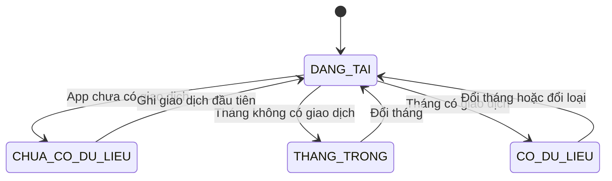
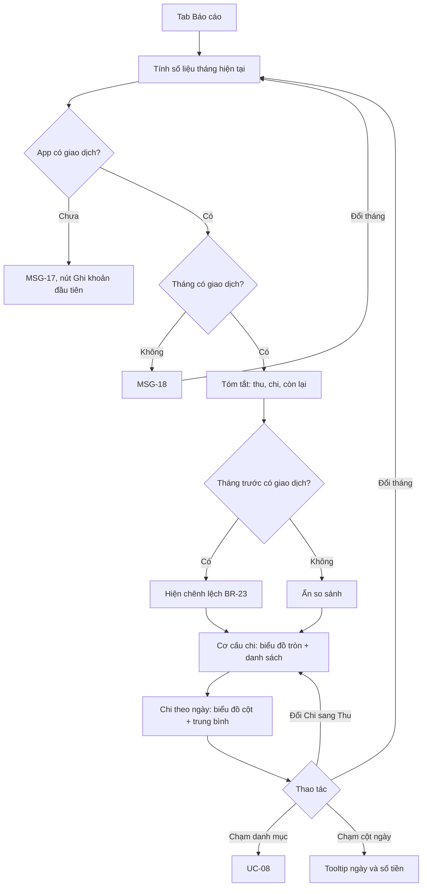
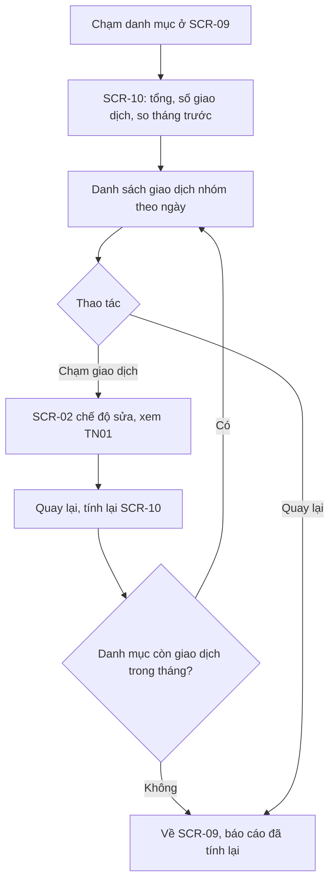
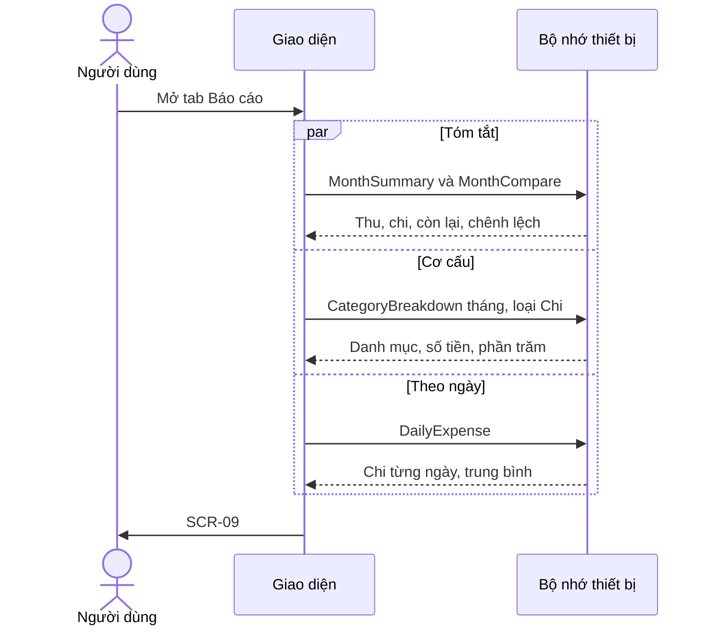

> **Mã:** DE02-TN03-SRS · **Trạng thái:** nháp · **Người viết:** Design (mock) · **PRD:** [PRD.md](PRD.md)

# UC-DE02-03 - Báo cáo tháng

> **Bản mock.** Giá trị `[giả định]` cần BA xác nhận. Giao dịch xem [SRS TN01](../TN01-ghi-thu-chi/SRS.md); danh mục và ngân sách xem [SRS TN02](../TN02-danh-muc-ngan-sach/SRS.md).

## 1. Tổng quan

| **Mục** | **Nội dung** |
| --- | --- |
| Mục tiêu | Người dùng xem tổng kết thu chi của tháng, cơ cấu theo danh mục, chi theo ngày và truy được về giao dịch |
| Actor | Người dùng · Hệ thống (app và bộ nhớ trên thiết bị) |
| Phạm vi | Báo cáo theo tháng; so với tháng trước; chi tiết theo danh mục |
| Ngoài phạm vi | Báo cáo tuần, quý, năm; xu hướng nhiều tháng; xuất ảnh, PDF |
| Nền tảng | App iOS / Android `[giả định]` |
| Figma | `[chưa có]` |

## 2. User Story

| **ID** | **As a** | **I want** | **So that** |
| --- | --- | --- | --- |
| US-11 | Người dùng | Xem tổng thu, chi, còn lại của tháng | Biết tình hình chung |
| US-12 | Người dùng | Xem cơ cấu chi theo danh mục | Biết tiền đi đâu nhiều nhất |
| US-13 | Người dùng | So với tháng trước | Biết mình tiêu nhiều lên hay ít đi |
| US-14 | Người dùng | Xem giao dịch của một danh mục | Hiểu vì sao con số như vậy |
| US-15 | Người dùng | Xem chi theo ngày | Biết ngày nào tiêu nhiều |

## 3. Business Rules

| **Mã** | **Quy tắc** |
| --- | --- |
| BR-21 | **Kỳ báo cáo** là tháng theo lịch; mặc định tháng hiện tại; không xem được tháng tương lai; xem lùi tới tháng có giao dịch đầu tiên |
| BR-22 | **Tóm tắt**: tổng thu, tổng chi, còn lại = thu − chi; cùng công thức với BR-08 |
| BR-23 | **So với tháng trước**: tháng đã kết thúc → so với **cả** tháng trước. Tháng đang diễn ra → so **cùng kỳ**: tháng trước tính từ ngày 1 tới cùng ngày với hôm nay (tháng trước ngắn hơn thì tới ngày cuối tháng đó). Chênh lệch = tháng này − kỳ so sánh; phần trăm = chênh lệch / tháng trước, làm tròn số nguyên. Tháng trước bằng 0 → chỉ hiện chênh lệch tiền. Tháng trước không có giao dịch nào → không hiện so sánh |
| BR-24 | **Cơ cấu**: tỉ lệ danh mục = tổng của danh mục / tổng của loại trong tháng, làm tròn 1 chữ số thập phân; tổng các tỉ lệ hiển thị có thể lệch 0,1% do làm tròn |
| BR-25 | **Biểu đồ tròn** hiện 5 danh mục lớn nhất; các danh mục còn lại gộp thành "Còn lại". Ít hơn hoặc bằng 5 danh mục thì không có "Còn lại" `[giả định]` |
| BR-26 | **Chi theo ngày**: tổng chi mỗi ngày trong tháng; ngày chưa đến của tháng hiện tại để trống; trung bình ngày = tổng chi / số ngày đã qua (tháng hiện tại) hoặc số ngày của tháng (tháng đã qua) |
| BR-27 | Danh mục `DA_AN` vẫn hiện trong báo cáo. Danh mục có ngân sách hiện kèm hạn mức, phần trăm đã dùng và trạng thái theo BR-18 |
| BR-28 | Báo cáo tính lại mỗi khi mở màn và khi quay lại từ màn sửa giao dịch |

## 4. Trạng thái

### 4.1 Trạng thái màn báo cáo

| **Trạng thái** | **Điều kiện** | **Hiển thị** |
| --- | --- | --- |
| `DANG_TAI` | Đang tính số liệu | Skeleton; chỉ hiện nếu quá 300 ms |
| `CHUA_CO_DU_LIEU` | App chưa có giao dịch nào | MSG-17 + nút "Ghi khoản đầu tiên" |
| `THANG_TRONG` | Tháng đang xem không có giao dịch | MSG-18; vẫn cho chuyển tháng |
| `CO_DU_LIEU` | Tháng có ≥ 1 giao dịch | Tóm tắt + biểu đồ + danh sách |

Tháng có thu mà không có chi (hoặc ngược lại): phần cơ cấu của loại không có giao dịch hiện MSG-19.

## 5. Use Case

### UC-07 Xem báo cáo tháng

| **Mục** | **Nội dung** |
| --- | --- |
| Tiền điều kiện | Không có |
| Hậu điều kiện | Người dùng thấy số liệu tháng theo BR-21–27 |

**Luồng chính**

| **Bước** | **Actor** | **Mô tả** |
| --- | --- | --- |
| 1 | Người dùng | Mở tab Báo cáo |
| 2 | Hệ thống | Mở **SCR-09** với tháng hiện tại, loại Chi; tính số liệu (BR-22–26) |
| 3 | Hệ thống | Hiện tóm tắt kèm so sánh tháng trước (BR-23) |
| 4 | Hệ thống | Hiện cơ cấu theo danh mục (BR-24, BR-25) và chi theo ngày (BR-26) |
| 5 | Người dùng | Cuộn xem, chuyển tháng, đổi loại, chạm cột ngày |

**Luồng thay thế**

| **Mã** | **Điều kiện** | **Xử lý** |
| --- | --- | --- |
| A1 | App chưa có giao dịch | `CHUA_CO_DU_LIEU`: MSG-17 |
| A2 | Tháng không có giao dịch | `THANG_TRONG`: MSG-18 |
| A3 | Tháng trước không có giao dịch | Ẩn dòng so sánh |
| A4 | Tháng hiện tại | Hiện ghi chú MSG-20 dưới tóm tắt |
| A5 | Đổi sang Thu | Cơ cấu hiện theo danh mục thu; ẩn biểu đồ chi theo ngày |
| A6 | Loại đang xem không có giao dịch | Phần cơ cấu hiện MSG-19 |
| A7 | Chạm lát "Còn lại" | Cuộn xuống danh sách, tô sáng các danh mục thuộc "Còn lại" |

### UC-08 Xem chi tiết danh mục

| **Mục** | **Nội dung** |
| --- | --- |
| Tiền điều kiện | Danh mục có ≥ 1 giao dịch trong tháng đang xem |
| Hậu điều kiện | Người dùng thấy các giao dịch tạo nên con số của danh mục |

**Luồng chính**

| **Bước** | **Actor** | **Mô tả** |
| --- | --- | --- |
| 1 | Người dùng | Chạm một danh mục trong danh sách hoặc trên biểu đồ |
| 2 | Hệ thống | Mở **SCR-10**: tổng tiền, số giao dịch, chênh lệch so với tháng trước của danh mục |
| 3 | Hệ thống | Liệt kê giao dịch của danh mục trong tháng, nhóm theo ngày |
| 4 | Người dùng | Chạm giao dịch để sửa (UC-02) hoặc quay lại |
| 5 | Hệ thống | Tính lại số liệu khi quay lại (BR-28) |

**Luồng thay thế**

| **Mã** | **Điều kiện** | **Xử lý** |
| --- | --- | --- |
| A1 | Sửa giao dịch sang danh mục hoặc tháng khác | Giao dịch rời **SCR-10**; tổng tính lại |
| A2 | Xoá hết giao dịch của danh mục | Tự quay về **SCR-09** |
| A3 | Danh mục có ngân sách | **SCR-10** hiện thêm thanh tiến độ ngân sách |

## 6. Điểm vào

| **Điểm vào** | **Dẫn tới** | **Ghi chú** |
| --- | --- | --- |
| Tab Báo cáo | UC-07, **SCR-09** | Mặc định tháng hiện tại, loại Chi |
| Thẻ số liệu ở **SCR-01** | UC-07, **SCR-09** | `[giả định]` |
| Danh mục trong **SCR-09** | UC-08, **SCR-10** | |
| Nút "Xuất" ở **SCR-09** | **SCR-11** (SRS TN04) | Điền sẵn tháng đang xem |

## 7. Mô tả màn hình

### SCR-09 Báo cáo tháng

| **#** | **Thành phần** | **Loại** | **Hành vi** |
| --- | --- | --- | --- |
| 1 | Chọn tháng | Header | Nút trước, sau; nút sau disabled ở tháng hiện tại; nút Xuất |
| 2 | Thẻ tóm tắt | Card | Tổng thu, Tổng chi, Còn lại; mỗi số kèm "▲ / ▼ {số tiền} ({x}%) so với tháng {m}" |
| 3 | Ghi chú tháng hiện tại | Text phụ | MSG-20 |
| 4 | Chọn loại | Segmented | Chi (mặc định), Thu |
| 5 | Biểu đồ tròn | Donut chart | 5 danh mục lớn nhất + Còn lại; giữa biểu đồ là tổng của loại; chạm lát → tô sáng dòng tương ứng |
| 6 | Danh sách danh mục | List | Biểu tượng, tên, số tiền, phần trăm, thanh tỉ lệ; nhãn ngân sách nếu có; chạm → **SCR-10** |
| 7 | Chi theo ngày | Bar chart | Cột mỗi ngày; đường trung bình ngày; chạm cột hiện tooltip |
| 8 | Màn trống | Empty state | Theo mục 4.1 |

### SCR-10 Chi tiết danh mục

| **#** | **Thành phần** | **Loại** | **Hành vi** |
| --- | --- | --- | --- |
| 1 | Header | Header | Biểu tượng, tên danh mục, tháng |
| 2 | Tóm tắt danh mục | Card | Tổng tiền, "{n} giao dịch", chênh lệch so với tháng trước |
| 3 | Tiến độ ngân sách | Progress | Chỉ hiện khi danh mục có ngân sách |
| 4 | Danh sách giao dịch | List nhóm theo ngày | Dòng giao dịch dùng chung (SRS TN01); chạm → **SCR-02** |

## 8. Dữ liệu và thao tác

| **Thao tác** | **Input chính** | **Output chính** | **Ghi chú** |
| --- | --- | --- | --- |
| \[MonthSummary\] | month | total_income, total_expense, balance | Dùng chung với TN01 |
| \[MonthCompare\] | month | Chênh lệch tiền và phần trăm của thu, chi, còn lại | BR-23 |
| \[CategoryBreakdown\] | month, type | Từng danh mục: total, percent, txn_count, budget_status | BR-24, BR-27 |
| \[DailyExpense\] | month | Từng ngày: total; daily_average | BR-26 |
| \[TxnListByCategory\] | month, category_id | Giao dịch nhóm theo ngày | |

## 9. Danh sách thông báo

| **ID** | **Nơi hiện** | **Nội dung (VI)** |
| --- | --- | --- |
| MSG-17 | **SCR-09** | Báo cáo sẽ hiện ở đây khi bạn có giao dịch. \[Ghi khoản đầu tiên\] |
| MSG-18 | **SCR-09** | Không có giao dịch nào trong tháng {m}/{yyyy} |
| MSG-19 | **SCR-09**, phần cơ cấu | Chưa có khoản {chi / thu} nào trong tháng này |
| MSG-20 | **SCR-09** | Tháng chưa kết thúc, đang so với cùng kỳ tháng {m} (ngày 1–{d}) |

Bản EN: `[chờ bổ sung]`.

## 10. Yêu cầu phi chức năng

| **Mục** | **Yêu cầu** `[giả định]` |
| --- | --- |
| Hiệu năng | **SCR-09** hiện ≤ 1 giây với 10.000 giao dịch; đổi tháng ≤ 500 ms |
| Chính xác | Tổng các danh mục bằng đúng tổng của loại; phép tính trên số nguyên |
| Offline | Toàn bộ chức năng chạy không cần mạng |
| Bảo mật | Báo cáo tính trên máy, không gửi số liệu ra ngoài; số tiền không đưa vào tracking |
| Log / audit | Chỉ ghi lỗi tính và lỗi vẽ báo cáo, kèm tháng và thời điểm |
| Tracking | Mở báo cáo, đổi tháng, đổi loại, chạm danh mục, chạm cột ngày, bấm Xuất |
| Accessibility | Biểu đồ có bản thay thế dạng danh sách cho trình đọc màn hình; lát biểu đồ phân biệt bằng nhãn chữ, không chỉ bằng màu; tăng giảm có chữ "tăng", "giảm" kèm mũi tên |
