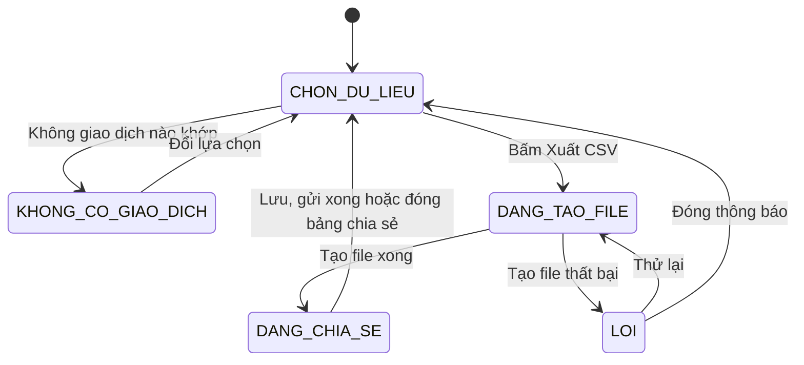
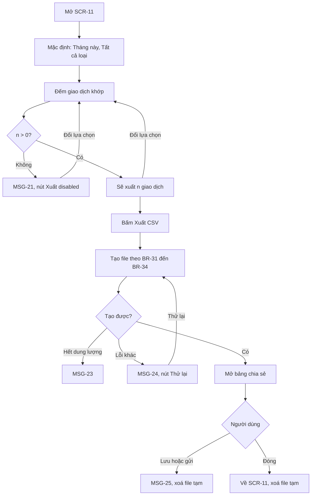
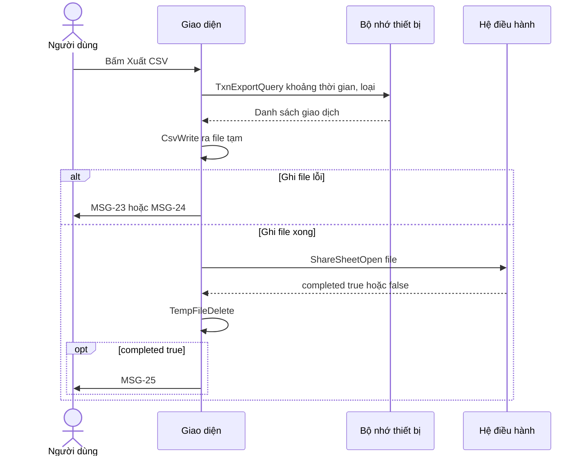

> **Mã:** DE02-TN04-SRS · **Trạng thái:** nháp · **Người viết:** Design (mock) · **PRD:** [PRD.md](PRD.md)

# UC-DE02-04 - Xuất CSV

> **Bản mock.** Giá trị `[giả định]` cần BA xác nhận. Giao dịch xem [SRS TN01](../TN01-ghi-thu-chi/SRS.md).

## 1. Tổng quan

| **Mục** | **Nội dung** |
| --- | --- |
| Mục tiêu | Người dùng xuất giao dịch theo khoảng thời gian thành file CSV để lưu hoặc gửi đi |
| Actor | Người dùng · Hệ thống (app) · Bảng chia sẻ của hệ điều hành |
| Phạm vi | Chọn khoảng thời gian, loại giao dịch; tạo file; chia sẻ |
| Ngoài phạm vi | Nhập CSV, xuất .xlsx và PDF, sao lưu đám mây |
| Nền tảng | App iOS / Android `[giả định]` |
| Figma | `[chưa có]` |

## 2. User Story

| **ID** | **As a** | **I want** | **So that** |
| --- | --- | --- | --- |
| US-16 | Người dùng | Chọn khoảng thời gian và loại giao dịch cần xuất | Chỉ lấy dữ liệu cần |
| US-17 | Người dùng | Biết trước sẽ xuất bao nhiêu giao dịch | Chắc chắn chọn đúng |
| US-18 | Người dùng | Nhận file CSV mở được trên bảng tính | Phân tích, sao lưu, gửi người khác |
| US-19 | Người dùng | Được báo rõ khi xuất lỗi | Biết cách thử lại |

## 3. Business Rules

| **Mã** | **Quy tắc** |
| --- | --- |
| BR-29 | **Khoảng thời gian**: Tháng này (mặc định), Tháng trước, Năm nay, Tất cả, Tuỳ chọn. Tuỳ chọn: từ ngày ≤ đến ngày ≤ hôm nay. Mở từ **SCR-09** thì điền sẵn tháng đang xem |
| BR-30 | **Loại**: Tất cả (mặc định), Chỉ chi, Chỉ thu |
| BR-31 | **Định dạng file**: CSV, UTF-8 có BOM, dấu phẩy ngăn cột, xuống dòng CRLF, dòng đầu là tiêu đề cột `[giả định]` |
| BR-32 | **Cột**: Ngày (dd/mm/yyyy), Loại (Chi, Thu), Danh mục (tên hiện tại), Số tiền (số nguyên dương, không dấu ngăn nghìn), Ghi chú |
| BR-33 | **Thoát ký tự**: ô chứa dấu phẩy, ngoặc kép hoặc xuống dòng được bọc trong ngoặc kép, ngoặc kép bên trong nhân đôi. Ô bắt đầu bằng =, +, -, @ được thêm dấu nháy đơn ở đầu để bảng tính không chạy như công thức |
| BR-34 | **Sắp xếp** theo ngày tăng dần, cùng ngày theo thời điểm tạo. **Tên file**: chi-tieu_{yyyymmdd}-{yyyymmdd}.csv; chọn Tất cả thì lấy ngày giao dịch đầu và cuối |
| BR-35 | Không có giao dịch khớp → không cho xuất. File tạm bị xoá sau khi bảng chia sẻ đóng |

## 4. Trạng thái

### 4.1 Trạng thái màn xuất



| **Trạng thái** | **Điều kiện** | **Hiển thị** |
| --- | --- | --- |
| `CHON_DU_LIEU` | Có ≥ 1 giao dịch khớp | Dòng "Sẽ xuất {n} giao dịch"; nút Xuất enabled |
| `KHONG_CO_GIAO_DICH` | Không giao dịch nào khớp | MSG-21; nút Xuất disabled |
| `DANG_TAO_FILE` | Đang ghi file | Nút hiện vòng xoay và "Đang tạo file…"; khoá các lựa chọn |
| `DANG_CHIA_SE` | Bảng chia sẻ đang mở | Bảng chia sẻ của hệ điều hành phủ lên |
| `LOI` | Tạo file thất bại | Popup MSG-23 hoặc MSG-24 |

## 5. Use Case

### UC-09 Xuất giao dịch ra CSV

| **Mục** | **Nội dung** |
| --- | --- |
| Tiền điều kiện | App có ít nhất 1 giao dịch |
| Hậu điều kiện thành công | File CSV được trao cho bảng chia sẻ; người dùng lưu hoặc gửi |
| Hậu điều kiện thất bại | Không có file; lựa chọn trên màn được giữ nguyên |



**Luồng chính**

| **Bước** | **Actor** | **Mô tả** |
| --- | --- | --- |
| 1 | Người dùng | Mở **SCR-11** từ Cài đặt hoặc nút Xuất ở **SCR-09** |
| 2 | Hệ thống | Chọn sẵn khoảng thời gian (BR-29) và loại Tất cả; đếm giao dịch khớp |
| 3 | Người dùng | Đổi khoảng thời gian, loại nếu cần |
| 4 | Hệ thống | Cập nhật "Sẽ xuất {n} giao dịch" |
| 5 | Người dùng | Bấm "Xuất CSV" |
| 6 | Hệ thống | Tạo file theo BR-31–34; hiện tiến trình; chặn bấm lại |
| 7 | Hệ thống | Mở bảng chia sẻ của hệ điều hành với file vừa tạo |
| 8 | Người dùng | Chọn lưu vào Tệp hoặc gửi qua ứng dụng khác |
| 9 | Hệ thống | Hiện MSG-25, xoá file tạm (BR-35) |

**Luồng thay thế**

| **Mã** | **Điều kiện** | **Xử lý** |
| --- | --- | --- |
| A1 | Chọn Tuỳ chọn | Hiện 2 ô Từ ngày, Đến ngày; mặc định ngày 1 của tháng này đến hôm nay |
| A2 | Không giao dịch nào khớp | `KHONG_CO_GIAO_DICH`: MSG-21 |
| A3 | Đóng bảng chia sẻ mà không chọn gì | Về **SCR-11**, không báo lỗi, giữ lựa chọn |
| A4 | Lần đầu xuất | Trước bước 6 hiện MSG-26 nhắc về dữ liệu nhạy cảm; chỉ hiện một lần |
| A5 | App chưa có giao dịch nào | Mục "Xuất dữ liệu" trong Cài đặt vẫn mở được; **SCR-11** ở `KHONG_CO_GIAO_DICH` |

**Luồng lỗi**

| **Mã** | **Điều kiện** | **Xử lý** |
| --- | --- | --- |
| E1 | Từ ngày sau Đến ngày | Ô Đến ngày tự đặt bằng Từ ngày; hiện MSG-22 |
| E2 | Thiết bị hết dung lượng | MSG-23 |
| E3 | Lỗi tạo file khác | MSG-24, nút Thử lại |
| E4 | App bị đưa xuống nền khi đang tạo file | Huỷ, xoá file dở; quay lại thì ở `CHON_DU_LIEU` |

## 6. Điểm vào

| **Điểm vào** | **Dẫn tới** | **Ghi chú** |
| --- | --- | --- |
| Cài đặt → Xuất dữ liệu | UC-09, **SCR-11** | Mặc định Tháng này |
| Nút Xuất ở **SCR-09** | UC-09, **SCR-11** | Điền sẵn tháng đang xem |

## 7. Mô tả màn hình

### SCR-11 Xuất dữ liệu

| **#** | **Thành phần** | **Loại** | **Bắt buộc** | **Validate / hành vi** |
| --- | --- | --- | --- | --- |
| 1 | Khoảng thời gian | Chip chọn 1 | Có | Tháng này, Tháng trước, Năm nay, Tất cả, Tuỳ chọn |
| 2 | Từ ngày | Date picker | Khi Tuỳ chọn | Không sau hôm nay |
| 3 | Đến ngày | Date picker | Khi Tuỳ chọn | Không trước Từ ngày, không sau hôm nay (E1) |
| 4 | Loại giao dịch | Segmented | Có | Tất cả, Chỉ chi, Chỉ thu |
| 5 | Xem trước | Text | – | "Sẽ xuất {n} giao dịch, từ {dd/mm/yyyy} đến {dd/mm/yyyy}" hoặc MSG-21 |
| 6 | Mô tả file | Text phụ | – | "File CSV gồm: Ngày, Loại, Danh mục, Số tiền, Ghi chú. Mở được bằng Excel, Google Sheets" |
| 7 | Nút "Xuất CSV" | Button | – | Disabled khi n = 0; đang tạo → vòng xoay, chặn bấm lại |

**Ví dụ nội dung file**

```csv
Ngày,Loại,Danh mục,Số tiền,Ghi chú
01/11/2026,Thu,Lương,15000000,Lương tháng 10
02/11/2026,Chi,Ăn uống,45000,"Phở, trà đá"
02/11/2026,Chi,Đi lại,12000,
03/11/2026,Chi,Mua sắm,320000,"Áo ""sale"" cuối tuần"
```

## 8. Dữ liệu và thao tác

| **Thao tác** | **Input chính** | **Output chính** | **Ghi chú** |
| --- | --- | --- | --- |
| \[TxnCount\] | from_date, to_date, type | Số giao dịch | Cập nhật xem trước |
| \[TxnExportQuery\] | from_date, to_date, type | Giao dịch đã sắp xếp, kèm tên danh mục | BR-34 |
| \[CsvWrite\] | Danh sách giao dịch | Đường dẫn file tạm | BR-31–33; ghi theo lô 1.000 dòng |
| \[ShareSheetOpen\] | Đường dẫn file | completed (bool) | API chia sẻ của hệ điều hành |
| \[TempFileDelete\] | Đường dẫn file | – | BR-35 |



## 9. Danh sách thông báo

| **ID** | **Nơi hiện** | **Nội dung (VI)** |
| --- | --- | --- |
| MSG-21 | Inline **SCR-11** | Không có giao dịch nào trong khoảng thời gian này |
| MSG-22 | Inline dưới ô ngày | Ngày kết thúc không được trước ngày bắt đầu |
| MSG-23 | Popup | Thiết bị không đủ dung lượng để tạo file. Vui lòng giải phóng dung lượng rồi thử lại |
| MSG-24 | Popup | Không tạo được file. \[Thử lại\] \[Đóng\] |
| MSG-25 | Toast | Đã xuất {n} giao dịch |
| MSG-26 | Popup (lần đầu) | File chứa toàn bộ thu chi trong khoảng thời gian đã chọn. Hãy cân nhắc trước khi gửi cho người khác. \[Đã hiểu\] |

Bản EN: `[chờ bổ sung]`.

## 10. Yêu cầu phi chức năng

| **Mục** | **Yêu cầu** `[giả định]` |
| --- | --- |
| Hiệu năng | Tạo file 10.000 giao dịch ≤ 3 giây; giao diện không bị đứng khi đang tạo |
| Tương thích | File mở đúng tiếng Việt trên Excel (Windows, macOS), Google Sheets, Numbers |
| Bảo mật | File chỉ nằm trong thư mục tạm của app cho tới khi chia sẻ; xoá sau khi dùng; không gửi qua máy chủ; ô bắt đầu bằng ký tự công thức được vô hiệu hoá (BR-33) |
| Offline | Tạo file không cần mạng |
| Log / audit | Ghi trên máy mỗi lần xuất: khoảng thời gian, loại giao dịch, số dòng, kết quả; không ghi nội dung file |
| Tracking | Mở màn xuất (nguồn), chọn khoảng thời gian, bấm Xuất (số giao dịch theo khoảng: 1–100, 101–1.000, trên 1.000), hoàn tất, huỷ, lỗi |
| Accessibility | Tiến trình tạo file được trình đọc màn hình thông báo; nút disabled có lý do đọc được |
